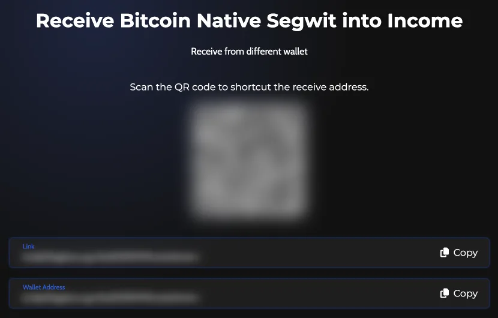
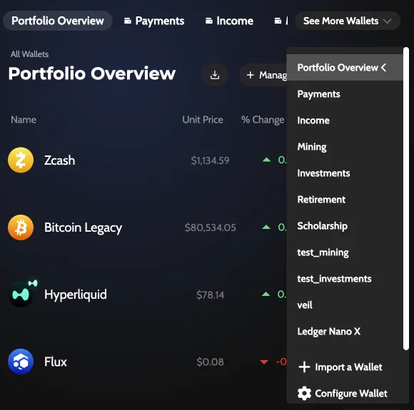
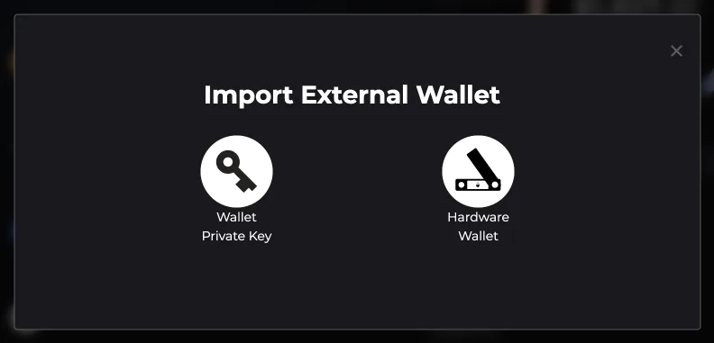
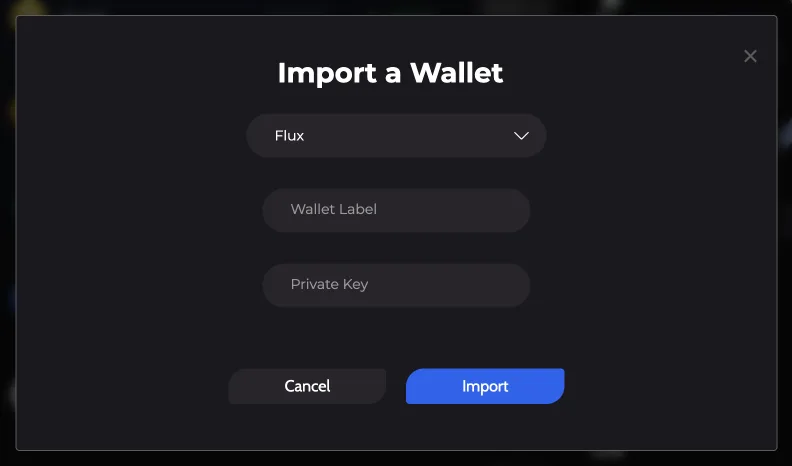

# Move Funds from Another Wallet to Zelcore

There are two ways to move crypto into Zelcore. You can **send** the funds from your old wallet or exchange to a Zelcore receive address, or you can **bring the old keys** into Zelcore by importing a private key or restoring a seed phrase. Sending is the cleaner choice: your funds end up under your Zelcore seed phrase, and the old keys stop mattering.

:::info Applies to Zelcore 8.39
Written for Zelcore 8.39.0 (October 2026).
:::

Background: [How to Add Coins in Zelcore: Enable Your First Chains](https://zelcore.io/academy/how-to/adding-your-first-coins-zelcore) on Zelcore Academy.

## Which method to use

| Method | Use it when | What to back up |
| --- | --- | --- |
| Send funds to Zelcore | You are leaving an exchange or another wallet, or you think the old wallet may be exposed | Your Zelcore seed phrase |
| Import a private key | You want to keep using one address from another wallet | The private key, separately from your Zelcore seed phrase |
| Restore a seed phrase | You want a whole wallet from another app in Zelcore | That seed phrase |

If the old wallet may be compromised, do not import its keys. Send the funds to a new Zelcore address instead, and see [Responding to a Wallet Compromise](./responding-to-wallet-compromise.md).

## Send funds to Zelcore

1. In Zelcore, open **Portfolio**, select the coin and select **Receive**.
2. Copy the **Wallet Address**.
3. In the old wallet or exchange, start a withdrawal or send of the same asset on the same network, and paste the Zelcore address.
4. Send a small test amount first. When it arrives in Zelcore, send the rest.

The old wallet or exchange charges its own network or withdrawal fee, shown there before you confirm. For the receive screen in detail, see [Send and Receive Crypto in Zelcore](./send-and-receive.md).

## Import a private key

1. Open **Portfolio**, open the wallet selector (**See More Wallets** on desktop, which opens when you hover over it) and select **Import a Wallet**.
2. In **Import External Wallet**, select **Wallet Private Key**. (**Hardware Wallet** also appears here in the desktop app; see [Ledger and Trezor on Zelcore Desktop](./hardware-wallets.md).)
3. Choose the coin. The form also has a **Wallet Label** field.
4. Paste the private key in **Private Key** and select **Import**.
5. Zelcore shows "Address imported successfully!" or "Wallet imported successfully!".

**Wallet Private Key** is available on desktop, mobile and the browser extension.

:::warning Back up imported keys separately
An imported private key is not created from your Zelcore seed phrase, so do not rely on that seed phrase to restore it. Keep your own backup of every private key you import.
:::

## Restore a seed phrase from another wallet

At login, **Import Seed Phrase** restores a Zelcore account from a seed phrase. Use a BIP-39 seed phrase of 12, 18 or 24 words: set the length under **Select the word count of the seed phrase** before you select **Import Seed Phrase**. Other wallets can derive addresses differently, so check that your balances appear after the restore. If an address you expect is missing, move those funds with [Send funds to Zelcore](#send-funds-to-zelcore) instead.

Full steps are in [Import an Existing Wallet](../getting-started/import-wallet.md).

## After you move funds

- **Finding balances**: the first time you log in on a device, Zelcore runs Smartify to find balances in your wallets. This takes around 2 minutes. See the [Wallet FAQ](../faq/wallet-faq.mdx) if a balance does not show.
- **Records for taxes**: Tax & CSV export can list your public addresses, which helps when a tax tool asks for every address you used. See [Export Transactions for Taxes (CSV)](../walkthroughs/tax-csv-export/index.md).

## Error messages

### "Please add at least one address to import"

The import form has no address or key yet. Paste the private key for the coin you chose, then confirm.

### "Coin [name] ([unit]) is not supported in wallet [wallet]!"

The coin you chose does not belong to the wallet you are importing into. For a token, add the address for the native coin of its blockchain first.

### "Invalid address"

The address or key does not match the coin you chose. Check that you picked the right coin and copied the full value.

## Related

- [Import an Existing Wallet](../getting-started/import-wallet.md)
- [Send and Receive Crypto in Zelcore](./send-and-receive.md)
- [Ledger and Trezor on Zelcore Desktop](./hardware-wallets.md)
- [Self-Custodial Wallets Explained](./self-custodial-wallets-explained.md)
- [Security Best Practices](../security/best-practices.md)
- [Zelcore support](https://support.zelcore.io)
