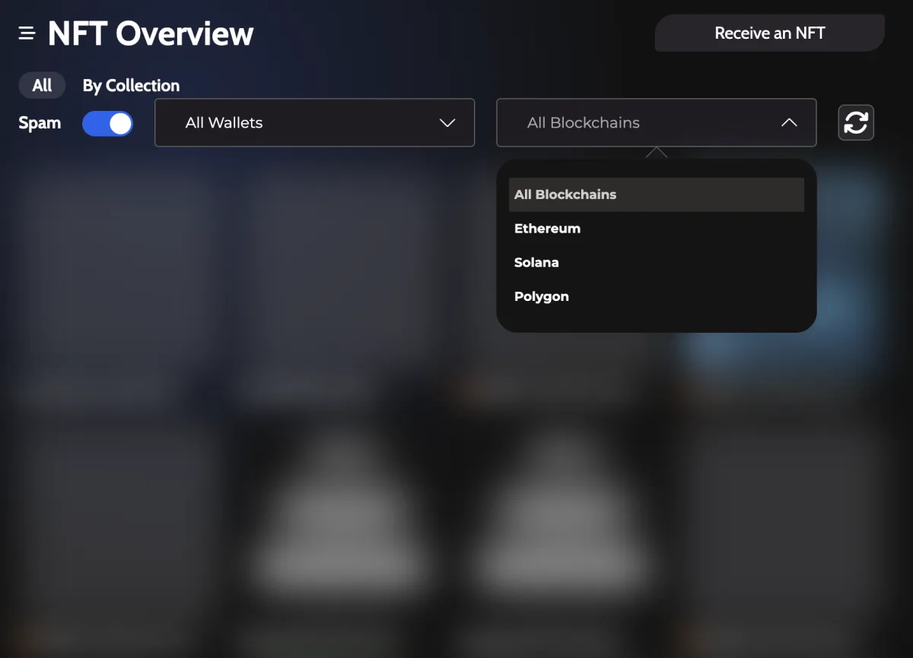
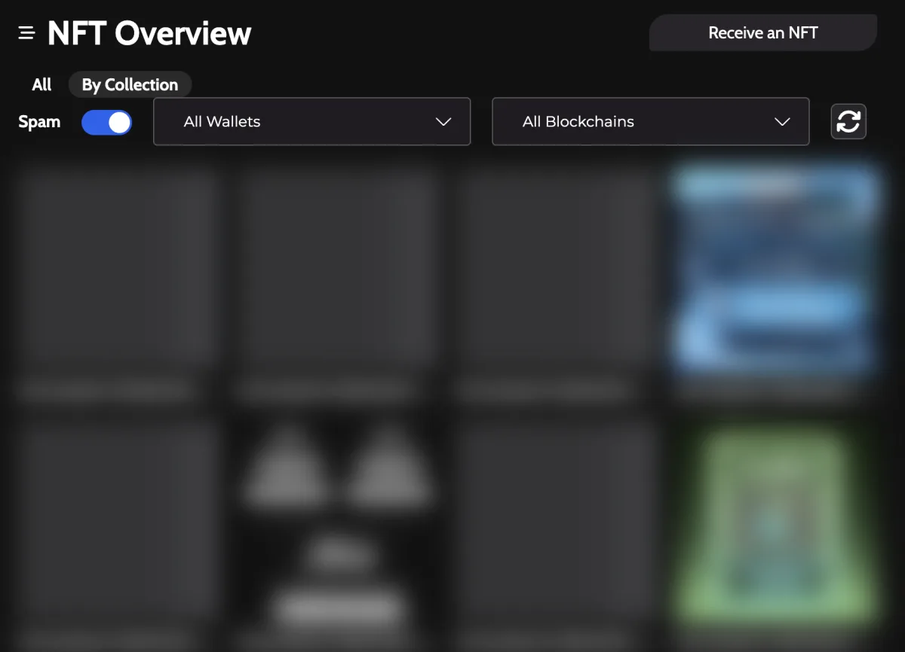
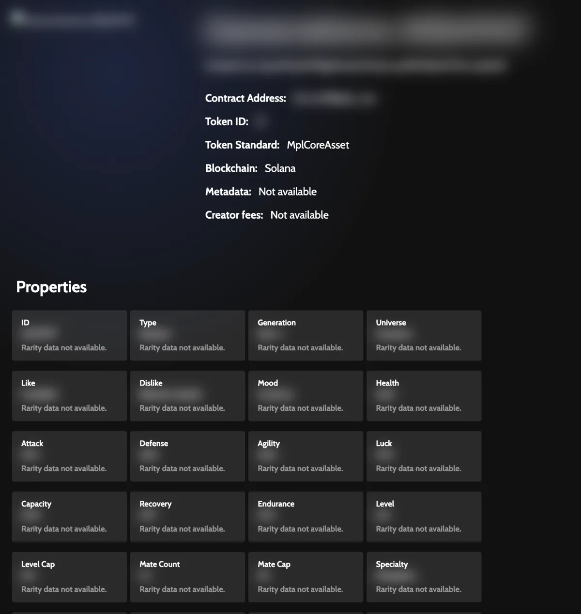
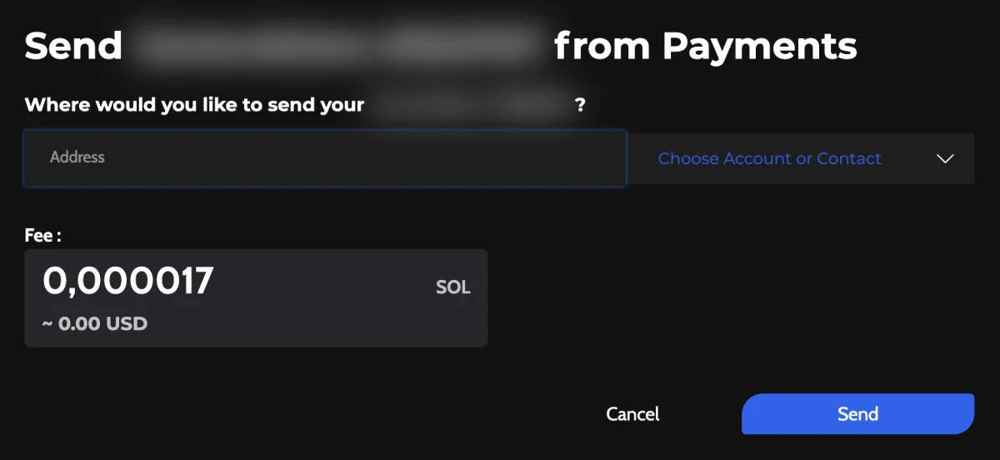
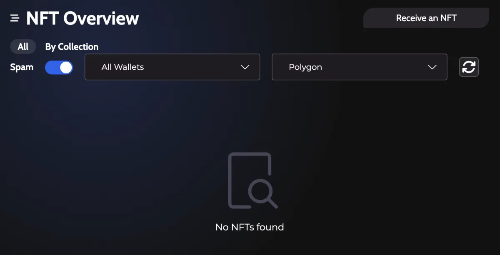

# NFT Gallery in Zelcore

The **NFTs** item in the Zelcore main menu opens a gallery that shows your NFTs on Ethereum, Polygon and Solana in one place. You can filter by blockchain or collection, hide items flagged as spam, open any NFT to see its properties, and send or receive NFTs from the same screen. The NFT gallery is available on desktop, Android and iOS. On a phone, open it from **Apps**.

:::info Applies to Zelcore 8.39
Written for Zelcore 8.39.0 (October 2026). The steps follow the desktop app.
:::

Background: [managing NFTs in a multi-chain wallet](https://zelcore.io/academy/nft/managing-nfts-multi-chain-wallet).

## What the gallery shows

The NFT portfolio gives you a common view for all your NFTs on Ethereum, Polygon and Solana. Zelcore reads the NFTs held by your wallets and lists them together. The **All Blockchains** filter lists every supported chain, whether or not your wallets hold NFTs on it.

The gallery has these views and filters:

- **NFT Overview**: the grid of your NFTs.
- **All**: every NFT, together.
- **By Collection**: NFTs grouped by the collection they belong to.
- **All Wallets**: a filter to show the NFTs of one wallet at a time.
- **All Blockchains**: a filter to show one blockchain at a time.
- **Spam**: a switch, on by default, that shows or hides NFTs flagged as spam.

## Browse your NFTs

1. Open **NFTs** from the left menu.
2. Use **All Blockchains** to pick a single chain, or leave it on all chains.

3. Choose **By Collection** to group NFTs by collection.

On Solana, you may see an **Unnamed Collection**. For Solana this can happen if the collection is not certified.

## View an NFT's details

Open an NFT to see its detail page with its properties. If the NFT has none, Zelcore shows "No properties for this NFT." Where the market data source provides it, the detail page also shows the collection's floor price.

## Send an NFT

1. Open **NFTs** and select the NFT you want to move.
2. Choose **Send**.
3. Enter the recipient address and confirm the details.
4. If d2FA is enabled on your account, enter your d2FA PIN when Zelcore asks for it (see [Set Up d2FA in Zelcore](/docs/security/d2fa/)).

Check the recipient address and the details Zelcore shows before you confirm. A blockchain transfer cannot be undone.

## Receive an NFT

1. Open **NFTs** and click **Receive an NFT**.
2. In the dialog, choose the wallet you want to receive into, then the blockchain.
3. Zelcore shows the address screen. Share that address with the sender.

## Troubleshooting

### No NFTs found

Nothing matches the current view or filter, or the selected wallet holds no NFTs. Switch the filter back to **All** and **All Blockchains**, then check that you are looking at the right wallet.

### There was an error requesting NFTs for 1, or more, of your wallets

Zelcore could not fetch NFTs for at least one wallet. Check your connection and open **NFTs** again. NFTs from the other wallets can still load. If the error stays, contact [Zelcore support](https://support.zelcore.io).

### There was an error fetching NFT ID

Zelcore could not load that NFT's details. Go back to the gallery and open it again. If it still fails, note the NFT ID shown in the message and contact [Zelcore support](https://support.zelcore.io).

### No properties for this NFT.

The NFT has no properties attached to it. This is not an error, and it does not affect sending or receiving.

## Platform note

The NFT gallery can vary by platform and region, and the app shows what is available on your device.

## Related

- [Buy crypto with fiat](/docs/guides/buying-crypto/)
- [Send and Receive Crypto in Zelcore](/docs/guides/send-and-receive/)
- [Zelcore features overview](/docs/features/overview/)
- [Security best practices](/docs/security/best-practices/)
- [Zelcore support](https://support.zelcore.io)
