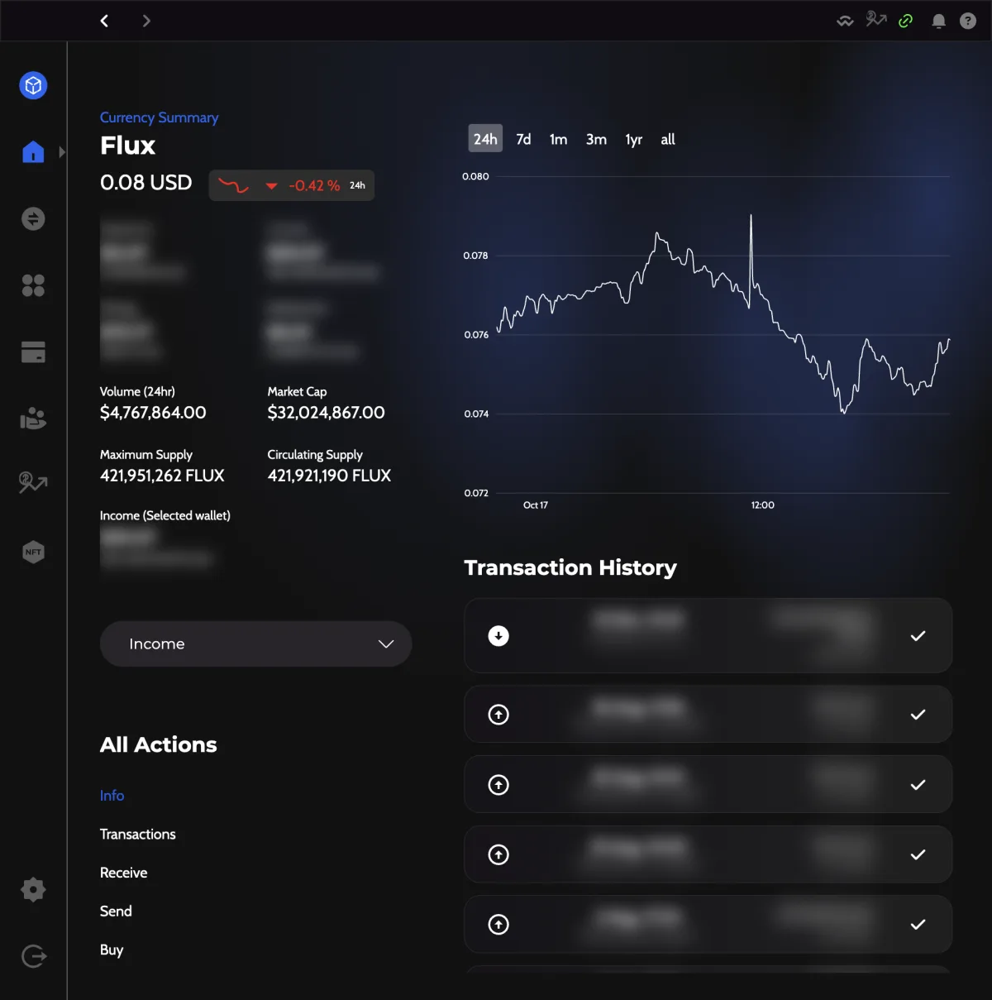
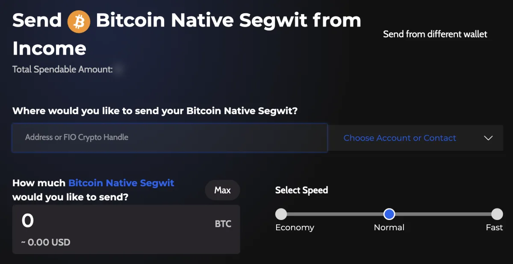
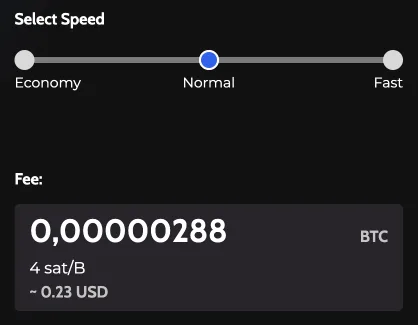
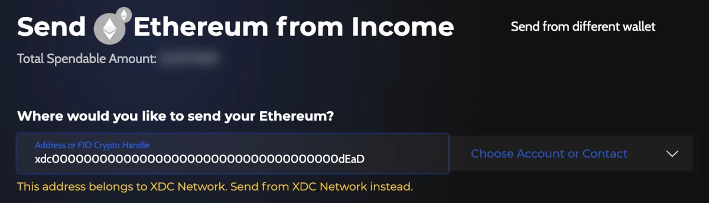
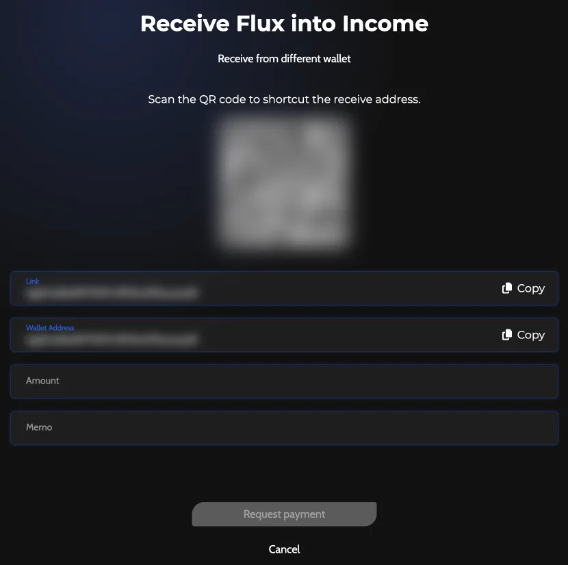

# Send and Receive Crypto in Zelcore

To send crypto in Zelcore, open the coin in **Portfolio**, select **Send**, enter the recipient and the amount, choose a speed and confirm. To receive, open the coin, select **Receive** and share the **Wallet Address** or its QR code. The network fee is shown in the app before you confirm.

:::info Applies to Zelcore 8.39
Written for Zelcore 8.39.0 (October 2026).
:::

Background: [Receive Crypto Safely in Zelcore: The Beginner Guide](https://zelcore.io/academy/how-to/receiving-crypto-safely-zelcore) on Zelcore Academy.

Desktop, mobile and the browser extension use the same send and receive screens. On desktop, **Send** and **Receive** are in the coin screen's **All Actions** list. On mobile and in the extension, start from the coin's action row.

## Send crypto

1. Open **Portfolio** and select the coin or token you want to send.
2. Select **Send**.
3. Under **Where would you like to send your [coin]?**, enter the recipient (see [who you can send to](#who-you-can-send-to)).
4. Under **How much [coin] would you like to send?**, enter the amount, or select **Max** to send the **Total Spendable Amount**.
5. Under **Select Speed**, choose **Economy**, **Normal** or **Fast**. On some chains the fee is set for you: the form says "Fee is calculated automatically by the network." On EVM chains you may also see a **Priority Fee**.
6. If the send form shows a memo, tag, payment ID or note field for this chain, fill it in when the recipient asks for one (see [memos, tags and payment IDs](#memos-tags-and-payment-ids)).
7. Select **Send**. With d2FA on, Zelcore asks for your PIN: enter it and select **Verify PIN and Send**. Otherwise Zelcore asks "Proceed with transaction?".
8. Zelcore shows **Transaction Sent!** when the transaction is broadcast.

Send a small test amount first when you use a new address.

<!-- screenshot: send-4 Confirmation / Verify PIN and Send -->
<!-- screenshot: send-5 "Transaction Sent!" dialog -->

### Who you can send to

The recipient field accepts:

- a wallet address on the same chain;
- an entry from **Contacts**, or one of your own wallets under **My Wallets**;
- a FIO handle;
- an OpenAlias name. If the record is not DNSSEC-authenticated, Zelcore warns you to double-check the address;
- on Kaspa, a KNS name such as `alice.kas` (added in 8.39.0). See [Kaspa (KAS) in Zelcore](../walkthroughs/kaspa-wallet/index.md).

### Network fees and speed

The fee goes to the blockchain network, not to the recipient. A faster speed costs more. Fee amounts change with network load, so they are shown in the app before you confirm. The speed choices depend on the chain.

### Memos, tags and payment IDs

On chains that support one, the send form shows an extra field below the amount. Its label depends on the chain:

| Chain | Field on the send form |
| --- | --- |
| Stellar, EOS, BNB, Terra, Avalanche X-Chain | **Memo** |
| TON and Cosmos chains | **Note**, with a **Memo** box |
| XRP | **TAG** |
| Monero | **Payment ID** (**Insert Payment ID**) |
| Native coins on EVM chains, Bitcoin-type coins, Algorand | **Note**, with a **Payment note (Memo)** box |

:::warning Exchange deposits
When an exchange or service gives you a memo, tag or payment ID for a deposit, enter it exactly as given. A deposit sent without it may not be credited to your account there.
:::

### Safety checks before you sign

- **Wrong chain**: on an EVM chain, if you enter an address with another chain's prefix (for example an XDC Network address starting with `xdc` on Ethereum), Zelcore says "This address belongs to [chain]. Send from [chain] instead."
- **Sending to yourself**: Zelcore warns "You are about to send funds to the same wallet address as you are using to send them with."
- **Scam screening**: Zelcore checks recipients, token spenders and dApps against known scam and drainer lists before you sign, and warns you on a match.
- **d2FA**: with d2FA on, no send is signed until you enter your PIN. See [Set Up d2FA in Zelcore](../security/d2fa.md).

## Receive crypto

1. Open **Portfolio** and select the coin or token you want to receive.
2. Select **Receive**.
3. Copy the **Wallet Address** with **Copy**, or let the sender scan the QR code.
4. To use another of your wallets for this coin, select **Receive from different wallet**.

Only send the matching asset on the matching network to this address. Funds sent on another chain may not arrive.

### Chains that need a setup step

- **Solana tokens**: if the token account for your address does not exist yet, select **Create Address** before you can receive the token.
- **Algorand assets**: your address must opt in to an asset first. Select **Allow Receive**.

## Hardware wallets (desktop)

A hardware-wallet account can only sign sends from the **Send** screen. Other actions that need a signature, such as paying for a swap, are not available from it. See [Ledger and Trezor on Zelcore Desktop](./hardware-wallets.md).

## Send error messages

### "Invalid address"

The address is mistyped or belongs to another chain. Copy it again from the recipient and check the first and last characters.

### "Insufficient funds"

The amount plus the network fee is more than your balance. Lower the amount or select **Max**.

### "Insufficient funds to pay [chain] transaction fee."

You need the chain's native coin to pay the fee, for example ETH for a token on Ethereum. Add some of the native coin to the same wallet.

### "Not enough confirmed [unit] in account to perform transaction"

Part of your balance is not confirmed yet. Wait for the incoming transactions to confirm, then try again.

### "Unable to obtain information about recipient address"

Zelcore could not look up the recipient on the network. Check the address and your connection, then try again.

### "No OpenAlias records found for: [domain]"

The name has no OpenAlias record for this coin. Ask the recipient for their address instead.

### "Minimum send amount is [amount] KAS"

Kaspa sends have a minimum amount, shown in the message. Send at least that amount.

### "Error sending transaction!"

The network did not accept the transaction. Wait a moment and try again. If it keeps failing, see [Troubleshooting Balance and Sync Issues](./troubleshooting-balance-sync-issues.md) or contact [Zelcore support](https://support.zelcore.io).

## Related

- [Kaspa (KAS) in Zelcore: KNS and KRC-20](../walkthroughs/kaspa-wallet/index.md)
- [Managing ERC-20 Tokens in Zelcore](./managing-erc20-tokens.md)
- [Swap Crypto in Zelcore: Fees and Limits](./swaps-fees-and-limits.md)
- [Move Funds from Another Wallet to Zelcore](./moving-funds-from-other-wallets.md)
- [Set Up d2FA in Zelcore](../security/d2fa.md)
- [Ledger and Trezor on Zelcore Desktop](./hardware-wallets.md)
- [Troubleshooting Balance and Sync Issues](./troubleshooting-balance-sync-issues.md)
- [Security Best Practices](../security/best-practices.md)
- [Zelcore support](https://support.zelcore.io)
