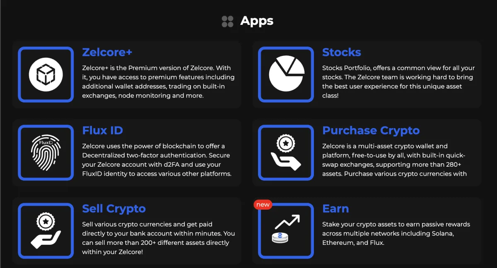
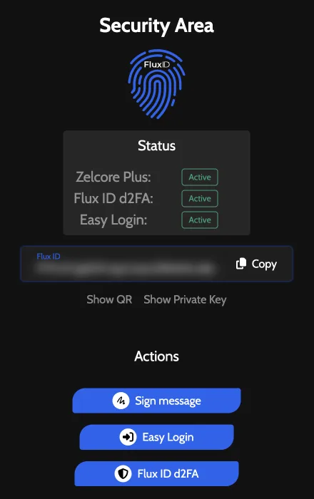
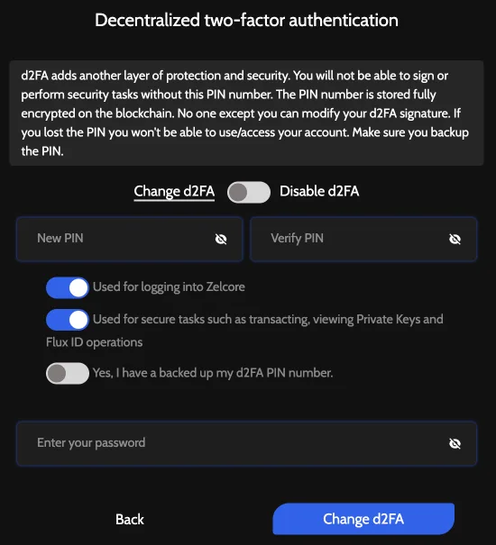
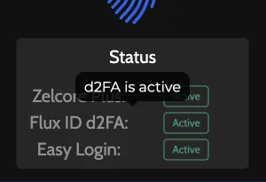

# Set Up d2FA in Zelcore

d2FA is Zelcore's decentralized two-factor authentication: a numeric PIN that you create in the **Flux ID** app, not in Settings. Zelcore stores the PIN encrypted on the Flux blockchain by sending a small FLUX transaction from the first Flux address in your account to your Flux ID address. Depending on the options you turn on, Zelcore asks for the PIN when you log in, before secure tasks such as sending, swapping, viewing private keys and Flux ID operations, or both.

:::info Applies to Zelcore 8.39
Written for Zelcore 8.39.0 (October 2026).
:::

## Before you start

- **Hold a little confirmed FLUX.** The setup transaction is paid from the first Flux address in your account. The app says: "d2FA requires a small amount of FLUX (~0.0002) to be present in your wallet to broadcast a d2FA 'enable' transaction." That figure is as of October 2026.
- **Decide how you will back up the PIN.** Write it down and keep it offline, the same way you keep your seed phrase.
- **Know what happens if you lose it.** The app's own warning: "You will not be able to sign or perform security tasks without this PIN number. The PIN number is stored fully encrypted on the blockchain. No one except you can modify your d2FA signature. If you lost the PIN you won't be able to use/access your account. Make sure you backup the PIN." Zelcore can't reset or recover the PIN, and restoring your seed phrase doesn't remove d2FA. See [If you forget your PIN](#if-you-forget-your-pin).

## Set up d2FA

The same Flux ID screens are in the desktop app, the mobile app and the browser extension.

1. Open **Apps** and choose the **Flux ID** tile.
   
2. The **Security Area** screen opens. Under **Actions**, choose **Flux ID d2FA**. In the status panel, the **Flux ID d2FA** row shows **Inactive** until you set it up (hover over the row to read "d2FA hasn't been setup yet").
   
3. Type a PIN in **New PIN** and the same PIN again in **Verify PIN**. The PIN is digits only, up to 10 digits.
4. Choose when Zelcore should ask for the PIN. Both option switches are on by default; turn off any you don't want, but keep at least one on:
   - **Used for logging into Zelcore**
   - **Used for secure tasks such as transacting, viewing Private Keys and Flux ID operations**
5. Turn on **Yes, I have a backed up my d2FA PIN number.** (this is the app's wording).
6. Enter your account password in **Enter your password**. On seed-phrase accounts this field is labelled **Easy Login Passphrase**.
   
7. Select **Create d2FA**. Zelcore broadcasts the setup transaction.
8. Wait until the transaction is confirmed on the Flux blockchain, then log out and log back in. The app says: "Your d2FA PIN will be set after the transaction is confirmed on the blockchain and you have re-logged in."
9. Open **Apps** > **Flux ID** again. In the status panel, **Flux ID d2FA** now shows **Active** (hover over the row to read "d2FA is active").
   

## When Zelcore asks for your PIN

**At login.** If you turned on **Used for logging into Zelcore**, the login screen also asks for your d2FA PIN.

**Before secure tasks.** If you turned on **Used for secure tasks such as transacting, viewing Private Keys and Flux ID operations**, a **d2FA** dialog opens with "Please authenticate your account using your PIN." Type the PIN in **PIN** and confirm. The button reads **Verify PIN and Send** on a send, **Verify PIN and Swap** on a swap and **Verify PIN** elsewhere. If you turned this option off, these screens don't ask for the PIN.

<!-- screenshot: d2fa-5 (d2FA PIN prompt on the Send screen) -->

With the secure-tasks option on, Zelcore asks every time, whatever the amount, on these screens:

- Send, including sending an NFT (see [Send and Receive Crypto in Zelcore](../guides/send-and-receive.md))
- Swaps, including **Swap Now** and the Fusion deposit (asked before signing since 8.39.0; see [Swap Crypto in Zelcore](../guides/swaps-fees-and-limits.md))
- Earn staking
- WalletConnect connection proposals and dApp requests (see [Connect Zelcore to dApps with WalletConnect](../guides/walletconnect.md))
- Showing a private key or seed phrase, and deleting a wallet
- Sign Message and other Flux ID operations
- FIO Crypto Handle, the FluxNodes dashboard, FluxDrive plans and the Zelcore+ subscription
- Kaspa UTXO consolidation and KRC-20 recovery, the Igra bridge and Ergo storage-rent actions

**Easy Login needs d2FA.** The app says: "Easy Login requires d2FA to be activated on your account and can only be activated for one account per device."

## Change or disable d2FA

To change the PIN or the options:

1. Open **Apps** > **Flux ID** > **Flux ID d2FA**.
2. Keep the switch on **Change d2FA**.
3. Fill in **New PIN**, **Verify PIN**, the option switches and the backup switch, then your password. Changing d2FA asks for your account password (or your biometric check if you use biometric Easy Login), not your current PIN.
4. Select **Change d2FA**. As with setup, the new settings apply after the transaction is confirmed and you log in again. Until then, log in with your previous settings.

To turn d2FA off:

1. Open **Apps** > **Flux ID** > **Flux ID d2FA**.
2. Move the switch to **Disable d2FA**.
3. Type your current PIN in **Verify PIN**.
4. Select **Disable d2FA**. Turning d2FA off needs your current PIN (or your biometric check if you use biometric Easy Login). There is no confirmation step: Zelcore sends a small FLUX transaction to turn d2FA off as soon as you select it.

## If you forget your PIN

Zelcore has no reset or "forgot PIN" option, and nobody at Zelcore can see or reset your PIN. What you can do depends on the options you turned on:

- **PIN used only for secure tasks.** You can still log in. Open **Apps** > **Flux ID** > **Flux ID d2FA**, keep the switch on **Change d2FA** and set a new PIN with your account password, as in [Change or disable d2FA](#change-or-disable-d2fa). The new PIN works after the transaction is confirmed and you log in again.
- **PIN used for logging in.** Zelcore asks for the PIN before it opens your account, so without it you can't use the account in Zelcore. The app warns about this when you create the PIN.

d2FA is a check in the Zelcore app. It doesn't change your keys, so your seed phrase still controls your funds.

## d2FA on a new device

Your d2FA settings live on the Flux blockchain, not on your device. When you restore your account on another device, Zelcore reads them when you log in and asks for the same PIN as before. Restoring the seed phrase doesn't set up a new PIN or turn d2FA off.

## d2FA error messages

### Not enough confirmed FLUX to setup d2FA

The first Flux address in your account doesn't hold enough confirmed FLUX for the setup transaction. Receive a small amount of FLUX to that address (the app asks for about 0.0002 FLUX as of October 2026), wait until it is confirmed, then try again.

### Your PIN is too long

The PIN can have at most 10 digits. Choose a shorter numeric PIN.

### PIN must be a number

Use digits only. Zelcore also shows this message when **New PIN** is empty.

### The PINs do not match

**New PIN** and **Verify PIN** are different. Type the same PIN in both.

### Please select at least one security option

Turn on **Used for logging into Zelcore**, **Used for secure tasks such as transacting, viewing Private Keys and Flux ID operations**, or both.

### Check that you backed up your d2FA PIN

Turn on **Yes, I have a backed up my d2FA PIN number.** after you have written the PIN down.

### Wrong PIN - Access denied

The PIN you typed before a secure task is wrong. Type it again carefully.

### Wrong d2FA PIN. One attempt remaining!

At login, Zelcore counts down your remaining attempts ("Three attempts remaining!", "Two attempts remaining!", "One attempt remaining!"). Check your PIN backup before you try again. After the last attempt Zelcore shows "Wrong d2FA PIN", closes the prompt and returns to the login screen, where you can start again.

### Your d2FA is not yet confirmed by the network. It will be activated soon.

The setup transaction hasn't been confirmed yet. Wait for confirmation, then log in again.

### Your d2FA is processing your recent request. To login you must use your previous settings.

A change is still waiting for confirmation. Log in with the PIN and options you had before the change.

### Spam transactions have been detected, please resend d2FA transaction.

Resend the d2FA transaction: open **Apps** > **Flux ID** > **Flux ID d2FA** and submit the form again. If it keeps happening, contact [Zelcore support](https://support.zelcore.io).

### Error while checking d2FA. Unable to log in at this time. Check your internet connection.

Zelcore couldn't read your d2FA status from the Flux network. Check your connection and try again.

### Error in d2FA certificate. Try again or contact the Zelcore team.

Try again. If it keeps happening, contact [Zelcore support](https://support.zelcore.io).

## Related

- [Send and Receive Crypto in Zelcore](../guides/send-and-receive.md)
- [Swap Crypto in Zelcore: Fees and Limits](../guides/swaps-fees-and-limits.md)
- [Connect Zelcore to dApps with WalletConnect](../guides/walletconnect.md)
- [Zelcore Browser Extension](../guides/browser-extension.md)
- [Security Best Practices](./best-practices.md)
- [Account access FAQ: d2FA questions](../faq/account-access-faq.mdx#d2fa-and-security)
- [Zelcore support](https://support.zelcore.io)
