# How to Bridge KAS to Igra L2 Using the Igra Bridge

To bridge KAS to Igra L2, open the Kaspa (Igra L2) asset in your portfolio, open the **Igra Bridge**, enter an amount (minimum 10 KAS) and confirm. The bridge locks your KAS on L1 and mints iKAS on Igra L2 at a 1:1 ratio. The same dialog bridges iKAS back to KAS, which typically arrives within 48-72 hours.

:::info Applies to Zelcore 8.39
The steps apply to Zelcore 8.39.0 (October 2026). Some screenshots come from an earlier version, so some screens may look slightly different.
:::

This walkthrough also gives a brief look at the ZAP Auction feature available on Igra L2.

---

## Prerequisites

- A Zelcore wallet with KAS tokens
- Zelcore desktop application installed and logged in
- Kaspa (Igra L2) asset added to your portfolio

---

## Step 1: Open Your Portfolio

Start from the **Portfolio Overview** in Zelcore. Your wallet displays all added assets along with their current balances, 24-hour price changes, and 7-day trends.

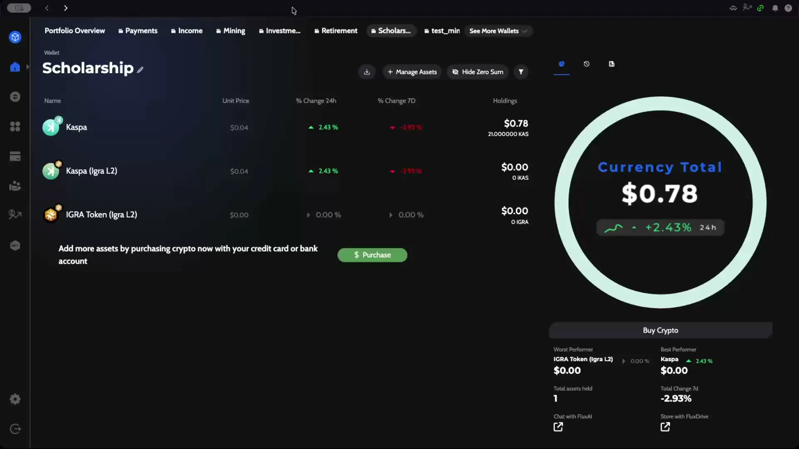

In this example, the **Scholarship** wallet holds three Kaspa-related assets:

| Asset | Description |
|-------|-------------|
| **Kaspa** | Native KAS on Layer 1 |
| **Kaspa (Igra L2)** | iKAS on the Igra Layer 2 network |
| **IGRA Token (Igra L2)** | The IGRA governance token on Igra L2 |

---

## Step 2: Expand the Kaspa (Igra L2) Asset

Click on **Kaspa (Igra L2)** in your portfolio to expand its details. This reveals market data, a price chart, and action buttons.

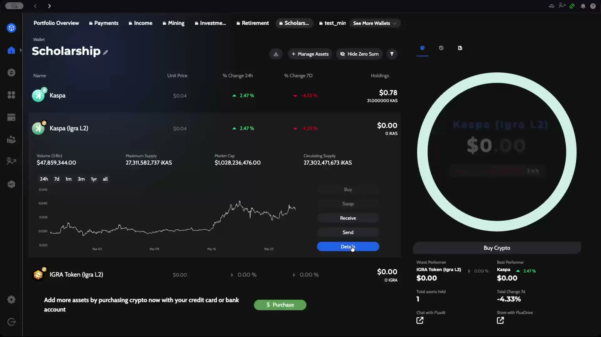

The expanded view shows:

- **Volume (24h)**, **Maximum Supply**, **Market Cap**, and **Circulating Supply**
- A price chart with selectable timeframes (24h, 7d, 1m, 3m, 1yr, all)
- Action buttons: **Buy**, **Swap**, **Receive**, **Send**, and **Details**

Click **Details** to navigate to the full asset details page where the Igra Bridge is available.

---

## Step 3: Open the Igra Bridge

On the Kaspa (Igra L2) details page, find **Igra Bridge** in the **All Actions** menu on the left side. Click it to open the bridge modal.

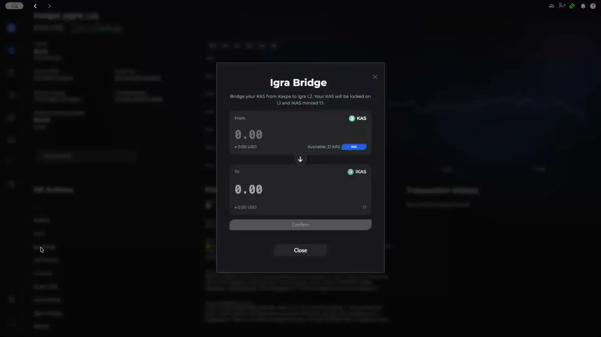

The Igra Bridge modal displays:

- **From** field — KAS (Layer 1), showing your available balance
- **To** field — iKAS (Igra L2), automatically calculated at a 1:1 ratio
- Your available KAS balance (in this case, 21 KAS)
- A **MAX** button to bridge your entire balance
- A **Confirm** button (grayed out until an amount is entered)

---

## Step 4: Enter the Amount to Bridge

Click the **From** field and enter the amount of KAS you want to bridge. The **To** field automatically mirrors the amount since the bridge uses a 1:1 ratio.

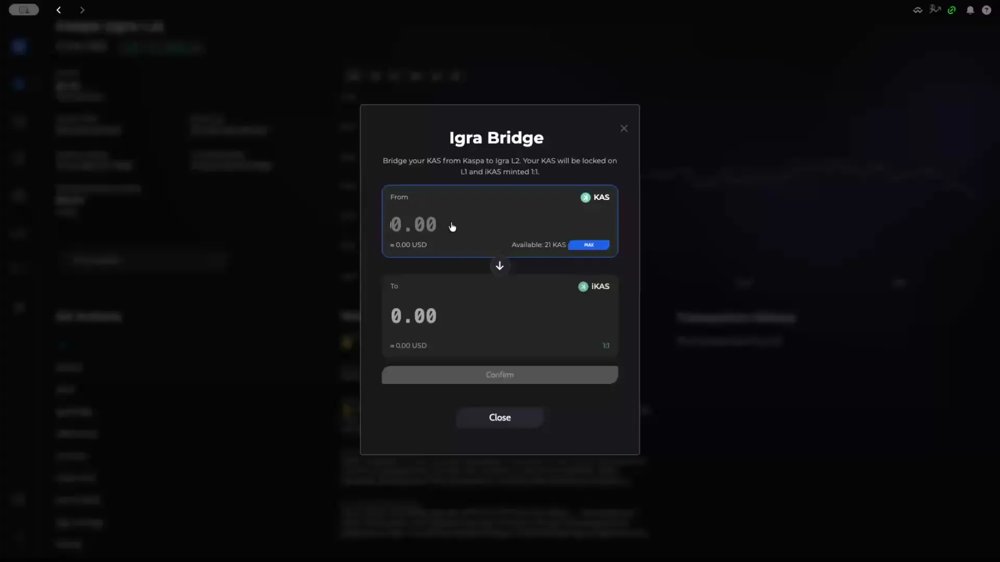

:::tip
The **MAX** button fills in your KAS balance minus 0.05 KAS. The bridge keeps this small amount free for the network fee, so you cannot bridge your full balance. Keep in mind that you may also want to retain a small amount for future L1 transaction fees. The minimum bridge amount is 10 KAS.
:::

---

## Step 5: Confirm the Bridge Transaction

After entering your desired amount (20 KAS in this example), the **Confirm** button becomes active. Click it to initiate the bridge.

A confirmation dialog appears asking **"Proceed with bridging KAS to iKAS?"** with two options:

- **No, Back** — Cancel and return to the bridge form
- **Yes, Initiate!** — Proceed with the bridge transaction

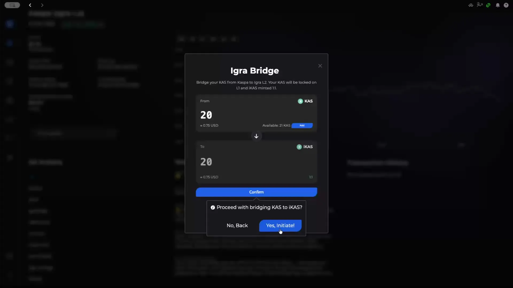

Click **Yes, Initiate!** to submit the transaction.

---

## Step 6: Wait for Transaction Processing

After confirming, a loading spinner appears while the transaction is being processed and broadcast to the network.

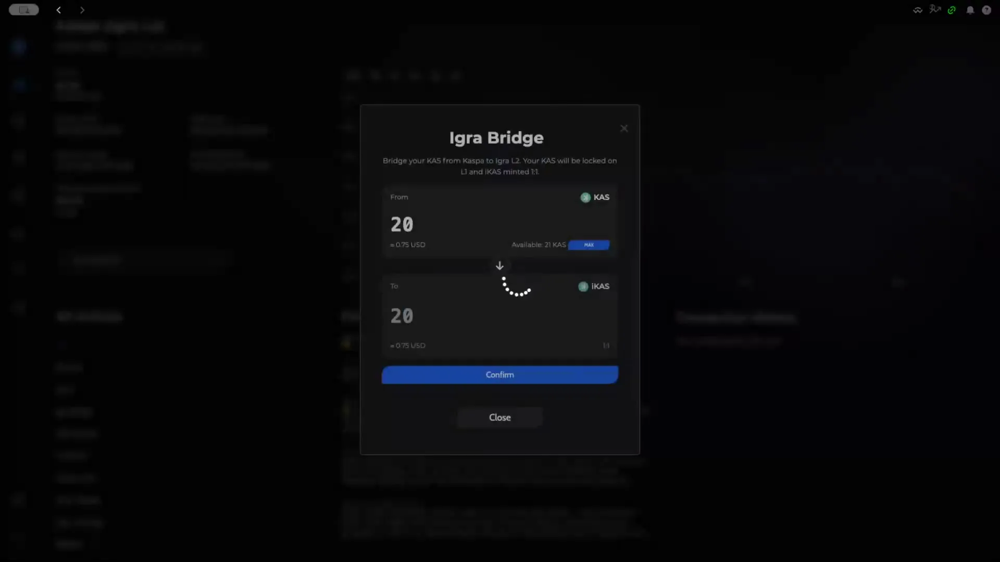

This typically takes just a few seconds.

---

## Step 7: Transaction Confirmation

Once the transaction is successfully sent, a **"Transaction Sent!"** screen appears with:

- A **QR code** for the transaction
- The **TX ID** (transaction hash) for reference
- A **Click to copy** option for the TX ID
- A **Show in explorer** button to view the transaction on the blockchain explorer

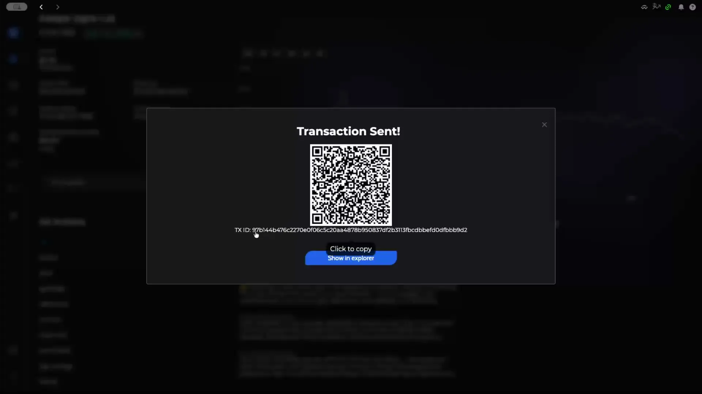

Shortly after, you'll receive an **Incoming Transaction** notification confirming that the iKAS has been received in your wallet.

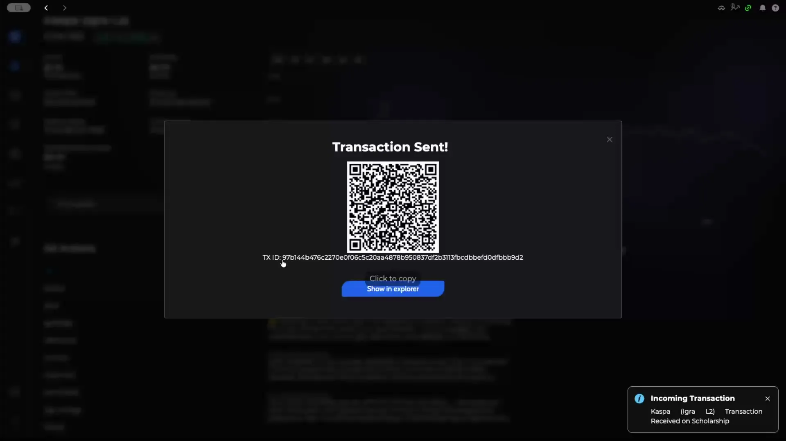

---

## Step 8: Verify Your Updated Balance

Navigate back to the Kaspa (Igra L2) details page. Your **Scholarship** wallet balance now reflects the bridged amount.

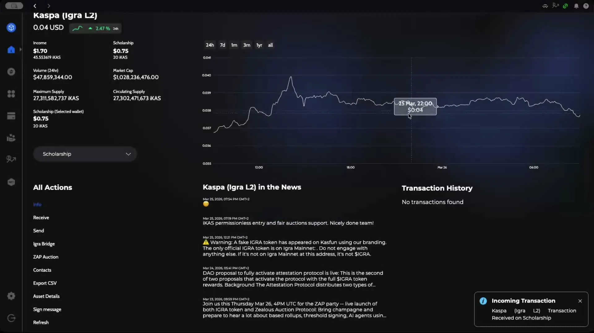

In this example, the wallet now shows:

- **Scholarship**: $0.75 / 20 iKAS
- **Income**: $1.70 / 45.55 iKAS

The details page also provides access to all available actions for iKAS, including **Info**, **Receive**, **Send**, **Igra Bridge**, **ZAP Auction**, **Contacts**, **Export CSV**, **Asset Details**, **Sign message**, and **Refresh**.

---

## Bridging iKAS Back to KAS

Version 8.39.0 adds the reverse direction. You can move iKAS from Igra L2 back to KAS on Kaspa in the same **Igra Bridge** dialog. The iKAS is burned on Igra, and the same amount of KAS is then sent to a Kaspa address you choose. The KAS typically arrives within 48-72 hours, with no guaranteed time.

:::warning
The burn cannot be undone. Your iKAS is burned as soon as the transaction confirms on Igra. KAS sent to a wrong address is lost, so check the address character by character.
:::

### Open the dialog in the iKAS to KAS direction

1. Open the **Kaspa (Igra L2)** details page and select **Igra Bridge** in the **All Actions** menu. When you open the bridge from the iKAS asset, it starts in the iKAS to KAS direction.
2. If it opens as KAS to iKAS, select the arrow button between the **From** and **To** fields to switch direction. Switching clears the amount.

The **From** field now shows iKAS with your available balance, and the **To** field shows KAS at a 1:1 ratio.

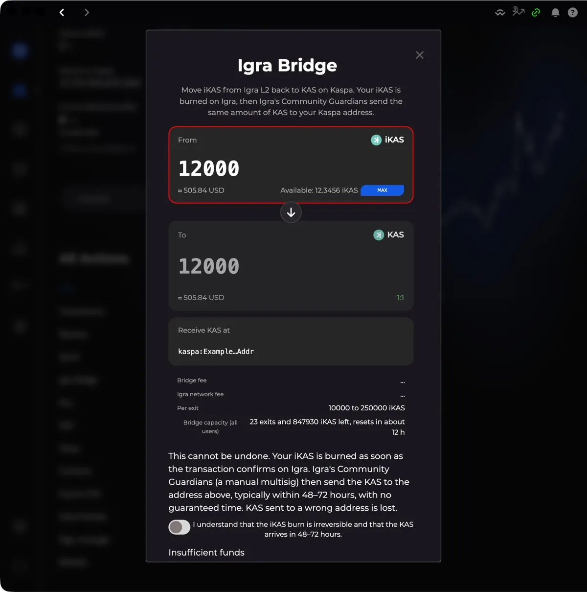

### Fill in the exit

1. Enter the amount of iKAS to bridge, or select **MAX**. MAX fills in the largest amount the bridge currently allows: your balance minus a small amount kept for the Igra network fee, limited by the per-exit maximum and by the remaining bridge capacity.
2. Under **Receive KAS at**, enter the Kaspa address that should receive the KAS. Select **Use my Kaspa address** to fill in your own Kaspa address. Only Kaspa mainnet addresses (starting with `kaspa:q` or `kaspa:p`) are accepted, and Zelcore refuses the Igra bridge's own address.
3. Review the details that appear under the address:

| Row | Meaning |
|-----|---------|
| **Bridge fee** | The fee charged by the bridge, in iKAS |
| **Igra network fee** | The estimated network fee on Igra, in iKAS |
| **Per exit** | The minimum and maximum amount for one exit |
| **Bridge capacity (all users)** | How many exits and how much iKAS are left in the current window, and when it resets |

Limits and fees are read live from the bridge, so they can change. If the fees change after you reviewed them, Zelcore asks you to check the new amounts and confirm again. If the bridge is paused, or the capacity for the current window is used up, the dialog says so and you can try again later.

### Confirm the exit

1. Read the warning and turn on the switch next to **I understand that the iKAS burn is irreversible and that the KAS arrives in 48–72 hours.**
2. Select **Confirm**. A confirmation asks whether to burn the amount of iKAS on Igra and receive the same amount of KAS at the address. Select **Yes, Initiate!**.
3. If d2FA is enabled, enter your PIN.

The exit is not available for hardware wallet accounts.

### Track your exits

Exits made from your Igra address are listed under **Your exits** in the dialog, and the list is kept after you restart Zelcore. Each entry shows the amount, the receiving address and one of these statuses:

| Status | Meaning |
|--------|---------|
| **Confirming on Igra** | The burn transaction has not confirmed yet |
| **Burned, KAS in 48–72 h** | The iKAS is burned and the KAS payout is pending |
| **KAS sent** | The KAS has been sent to your address |
| **Failed, nothing burned** | The transaction failed and no iKAS was burned |
| **May have been sent** | Igra did not confirm the exit in time, but it may have been sent |
| **Not found on Igra** | The transaction could not be found on Igra |

Use **Igra transaction** and **Kaspa transaction** to open each transaction in the explorer, **Refresh** to update the statuses, and **Remove** to delete an entry from the list. Removing an entry does not affect the exit itself. If an exit shows **May have been sent**, check the explorer before trying again, so you do not burn iKAS twice.

---

## Bonus: ZAP Auction

From the Kaspa (Igra L2) details page, click **ZAP Auction** to access the **Zealous Auctions Protocol** — a fair token launch platform on the Igra Network.

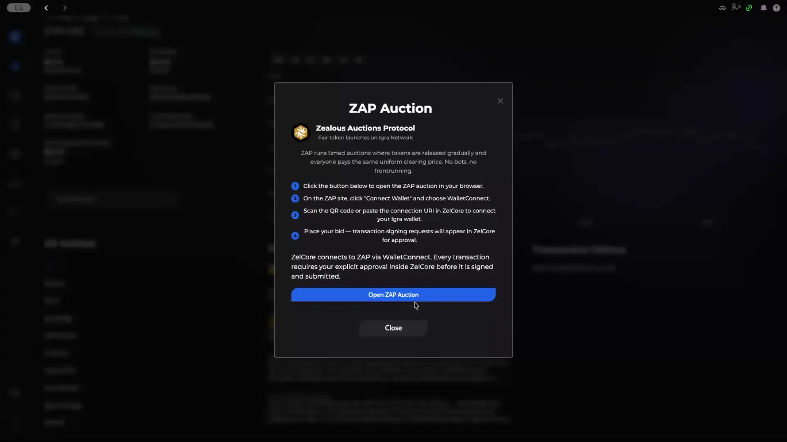

ZAP runs timed auctions where tokens are released gradually and everyone pays the same uniform clearing price. No bots, no frontrunning.

To participate:

1. Click **Open ZAP Auction** to open the auction site in your browser
2. On the ZAP site, click **Connect Wallet** and choose **WalletConnect**
3. Scan the QR code or paste the connection URI in Zelcore to connect your Igra wallet
4. Place your bid — transaction signing requests will appear in Zelcore for approval

:::info
Zelcore connects to ZAP via WalletConnect. Every transaction requires your explicit approval inside Zelcore before it is signed and submitted.
:::

---

## Summary

You've successfully bridged KAS from Kaspa Layer 1 to iKAS on Igra Layer 2 using Zelcore's built-in Igra Bridge. Your KAS is locked on L1 and an equivalent amount of iKAS is minted on Igra L2 at a 1:1 ratio.

With iKAS on Igra L2, you can now:

- **Send** and **Receive** iKAS on the Igra network
- Participate in **ZAP Auctions** for fair token launches
- Explore the growing Igra L2 ecosystem directly from Zelcore
- Bridge iKAS back to KAS at any time (see [Bridging iKAS Back to KAS](#bridging-ikas-back-to-kas))
