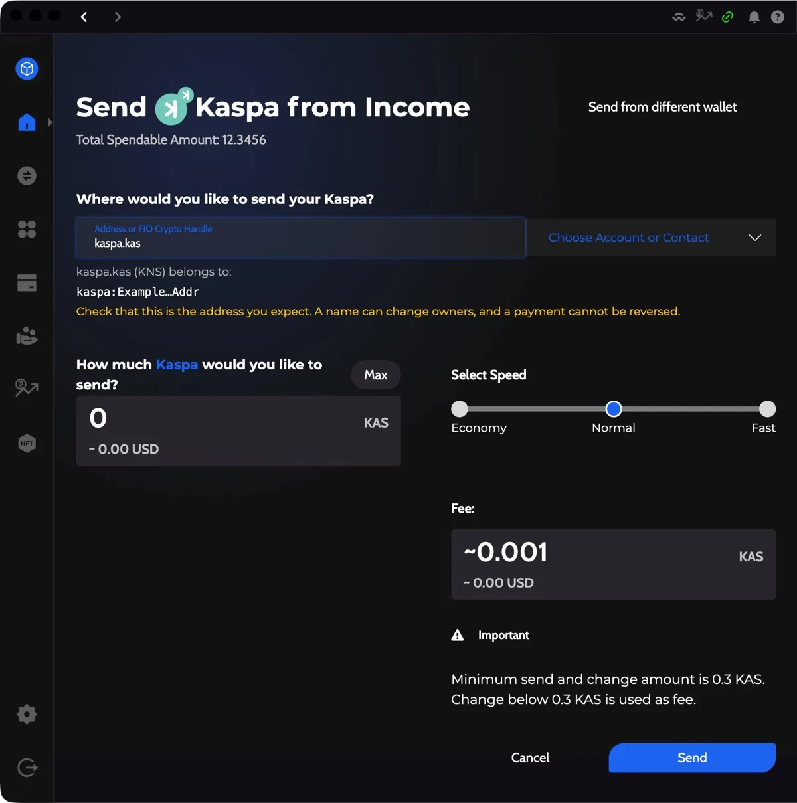
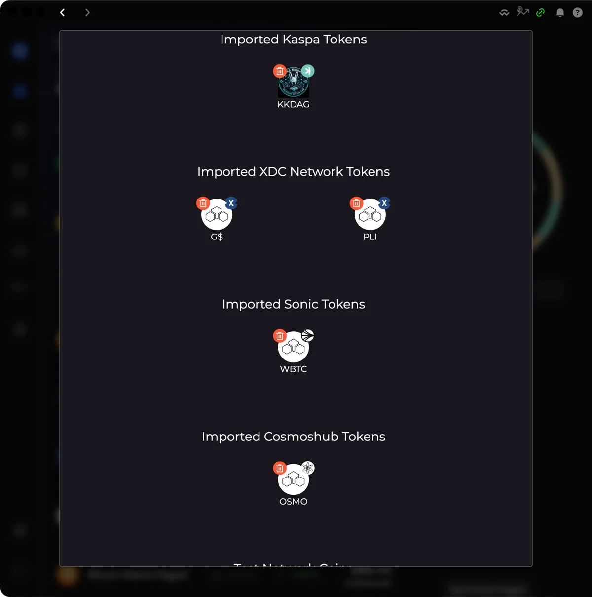
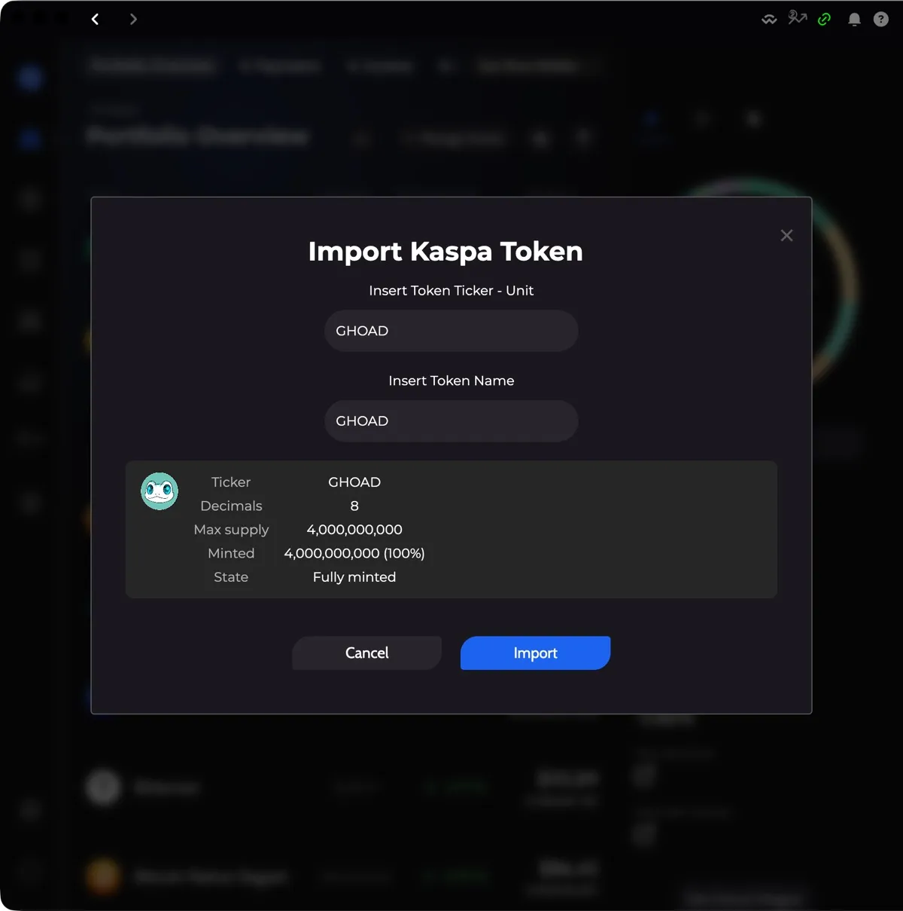
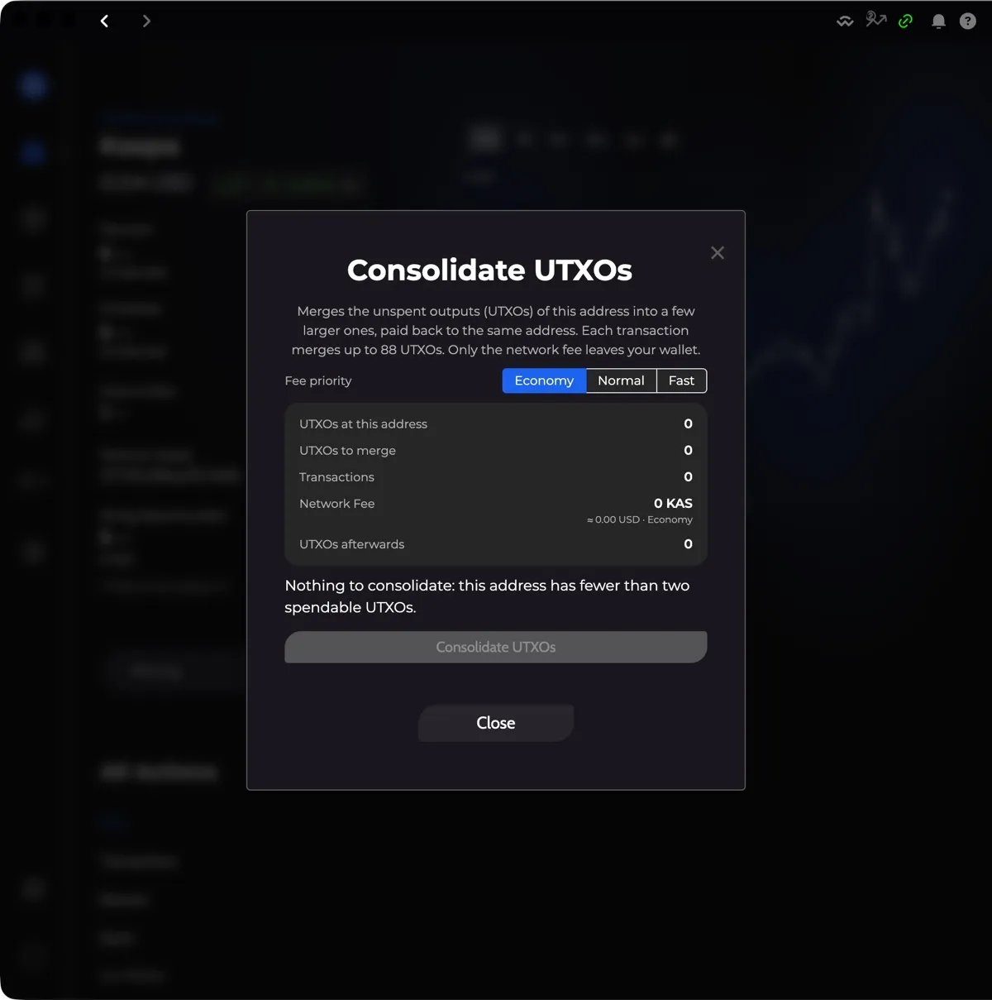
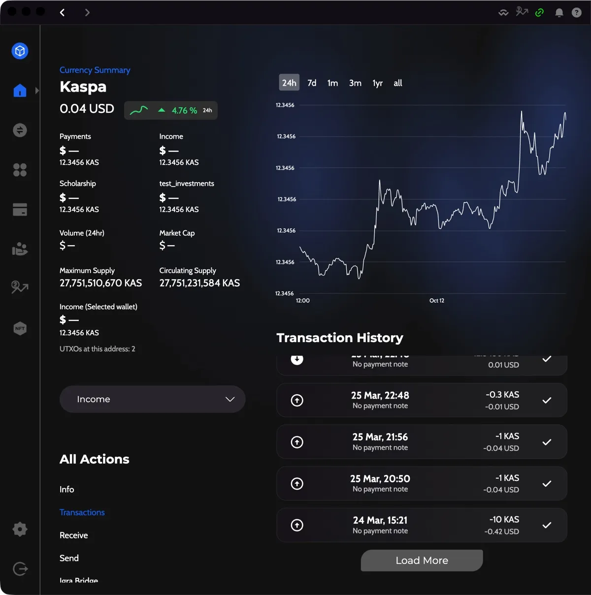
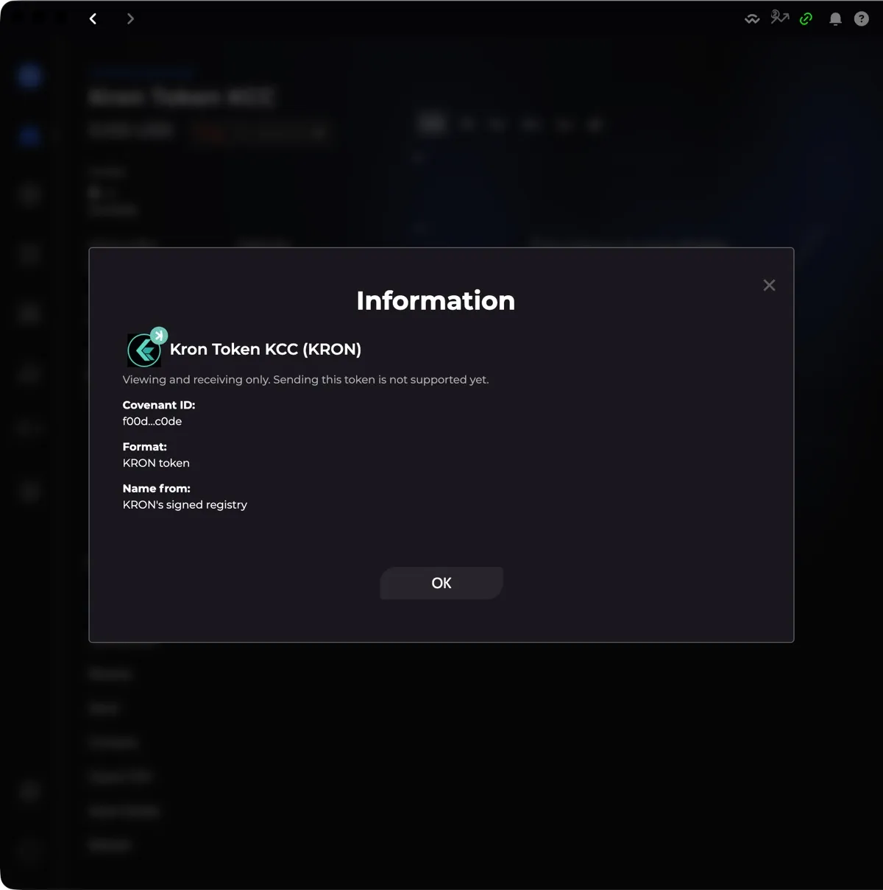
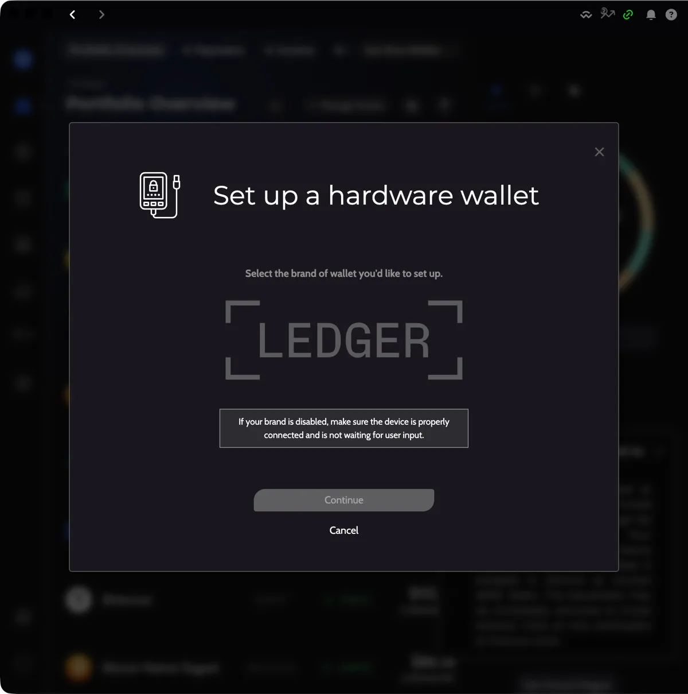

# Kaspa (KAS) in Zelcore: Names, KRC-20 Tokens and Ledger (Desktop)

Zelcore 8.39.0 adds several tools for Kaspa. You can send to a `.kas` name, find and import KRC-20 tokens, merge many small coins into a few, load older history, use a Ledger on Zelcore desktop, and sign messages.

This guide covers each one. Bridging KAS to Igra L2 is covered in the [Igra Bridge walkthrough](../igra-bridge).

---

## Send KAS to a Kaspa name (KNS)

KNS is the Kaspa Name Service. A name such as `alice.kas` points to a Kaspa address. You can type a name instead of the address when you send KAS or a KRC-20 token.

1. Open **Kaspa** in your portfolio and click **Send**.
2. In the recipient field, type the name, for example `alice.kas`.
3. Zelcore looks the name up. It shows **"alice.kas (KNS) belongs to:"** and the address underneath.
4. Compare that address with the one you expect.
5. Enter the amount and send as usual.

**Send stays disabled until the name resolves.** While Zelcore looks it up, you see "Looking up alice.kas on KNS…".

:::warning
Check the address under the name before you send. A name can change owner, and a payment cannot be reversed. Zelcore looks the name up again just before it signs. If the owner has changed since you last saw it, nothing is sent. Zelcore shows the new address, and you need to check it and send again.
:::

If a name does not resolve, Zelcore tells you why:

| Message | What it means |
|---------|---------------|
| "... is not a valid KNS name." | The name breaks the naming rules. |
| "... is not a registered KNS name." | Nobody owns this name. |
| "... is not a verified KNS domain." | Enter the address instead. |
| "Could not look up ... on KNS." | The lookup failed. Try again, or enter the address. |

Kaspa addresses are also checked as you type. Zelcore flags a missing `kaspa:` prefix, a wrong network, uppercase letters, or a typo (checksum mismatch).

---

## KRC-20 tokens

KRC-20 tokens live on Kaspa and are handled by the Kasplex indexer. Zelcore finds the ones your address holds, but you decide which to add.

### Why tokens are not added automatically

Anyone can send a token to any address. If Zelcore added every token it found, spam tokens would fill your portfolio. So Zelcore lists them and waits for you.

When Zelcore finds tokens, it shows a **"KRC-20 tokens found"** notice. It tells you to add only tokens you recognise.

### Add a token you hold

1. On the Portfolio, click **Manage Assets**, then **Add asset**.
2. Find the list called **Imported Kaspa Tokens**.
3. Add the tokens you want to your portfolio.

### Add a token by ticker and check it with Verify

If a token is not in the list, you can import it yourself. Click **Manage Assets**, then **Import Token**, and choose **Kaspa**. The **Import Kaspa Token** window opens.

1. Enter the ticker. A KRC-20 ticker is 4 to 6 letters (A-Z).
2. Optionally enter a name.
3. Click **Verify**.

Verify shows the token's logo, ticker, decimals, max supply, how much is minted, and its state (**Minting open** or **Fully minted**). If no token with that ticker was ever deployed, Zelcore says so and does not let you import it.

If the details look right, click **Import**.

### Send a KRC-20 token

Sending works like sending KAS. A token transfer needs a little extra KAS in the same wallet. Zelcore shows the amount on the send screen (0.3 KAS). Part of it comes back to you. You cannot send a token to the address it is sent from.

### Recover an interrupted token transfer

A token transfer happens in two steps on the network. First it sets aside a small KAS deposit (0.3 KAS). Then it completes the transfer. If the app closes or the connection drops between the two steps, the deposit stays on chain and the transfer is unfinished.

Zelcore finds these for you. On the **Kaspa** screen, and on the token's own screen, you see a card called **Unfinished token transfer**. It names the amount, the token, the receiving address, and the KAS held.

1. Click **Complete transfer**.
2. Confirm with **Yes, Send**. If d2FA is on, enter your PIN as for a normal send.
3. Zelcore completes the transfer. The KAS deposit returns to your wallet, less a small network fee.

Things to know:

- **View deposit** opens the deposit in the explorer.
- Zelcore only completes a deposit that is still there. It cannot send the same transfer twice.
- You cannot cancel it. Any spend of the deposit completes the same transfer.
- Kasplex applies the transfer when its indexer processes it. If your wallet no longer holds that amount by then, Kasplex rejects the transfer. The KAS comes back either way.

---

## Consolidate UTXOs

Every payment you receive is a separate coin on Kaspa, called a UTXO. Many small ones make large sends heavy: they get split into several transactions.

When your address holds more than 80 UTXOs, the Kaspa screen shows the count and a **Consolidate UTXOs** button. Click it to see the estimate before you sign:

- UTXOs at this address and how many will be merged
- The number of transactions
- The network fee, with a choice of fee priority
- UTXOs afterwards

Only the network fee leaves your wallet. The merged coins are paid back to the same address.

Consolidation needs a key that Zelcore holds. It is not available for hardware wallets. For the full explanation, see the [UTXO consolidation guide](../../guides/utxo-consolidation-guide).

---

## Transaction history

- **Load More.** Click **Load More** at the bottom of the list to fetch older transactions.
- **Live incoming payments.** While a Kaspa or KRC-20 screen is open, incoming payments show up within seconds. An incoming KRC-20 token transfer can take until the next regular refresh. If you route Zelcore through a proxy server, live updates do not apply and the regular refresh is used.
- **Pending and failed.** A transaction the network has not accepted yet shows as pending. If the network still has not accepted it after about 10 minutes, it shows as an error instead of a success. Earlier versions showed these as successful.
- **KRC-20 history.** Token screens now list transfers, mints, and marketplace trades. They used to be empty. Your KAS balance updates right after a KRC-20 send.

Token history and balances come from the Kasplex indexer. Zelcore is not responsible for the accuracy of indexer data.

---

## KCC tokens (view only)

KCC tokens are Kaspa covenant tokens, such as KRON and KCC-20 tokens. Zelcore finds the ones at your address, checks them against Zelcore's own Kaspa node, and lists them under **Imported Kaspa Tokens**, like KRC-20 tokens. You add them to your portfolio yourself.

For each token you see the balance, supply, and history. The information window also shows the covenant ID, the token format, and where its name comes from.

**You cannot send KCC tokens yet.** If you click **Send**, Zelcore says: "Viewing and receiving only. Sending this token is not supported yet."

If the token indexer or the Kaspa network is unavailable, Zelcore shows the last checked balance and the date.

---

## Kaspa on Ledger (Zelcore desktop)

You can import a Kaspa address from a Ledger device in Zelcore desktop and send KAS from it.

1. On Zelcore desktop, connect your Ledger, unlock it, and open the **Kaspa** app on it.
2. In Zelcore, open **See More Wallets**, click **Import a Wallet** and choose **Hardware Wallet**.
3. Follow the steps: **Select Coin**, **Open App on Device**, **Select Address**, **Confirm & Import**, then **Summary**.
4. Zelcore desktop shows the address on your Ledger. Check it and confirm.

To send, use **Send** as usual and approve the transaction on the device. Nothing is sent until you approve on the device.

- A send that has to combine many small coins first needs more than one approval on the Ledger (Zelcore desktop). Zelcore tells you how many.
- You cannot attach a message when you send from a Ledger on Zelcore desktop.
- Part of a balance can be locked in outputs the Ledger Kaspa app cannot spend (Zelcore desktop). These come from transactions with more than 256 outputs, such as some pool payouts. If you see this message, try a smaller amount.
- **KRC-20 tokens on Ledger (Zelcore desktop) are not supported yet.**
- Sign Message and UTXO consolidation are not available for hardware wallets.

---

## Sign a message

You can sign a message with a Kaspa address. The signature uses the format that Kaspa NG and KasWare use, so those wallets can verify it.

1. Open the **Kaspa** screen and click **Sign message**. This link is not shown for hardware wallets.
2. Pick the wallet and enter your message.
3. Click **Sign message**, and enter your d2FA PIN if it is on.
4. Copy the signature from the **Message Signature** window.

The signature is 128 hexadecimal characters. Messages are signed with Schnorr signatures on Kaspa `kaspa:q...` addresses.

---

## FAQ and troubleshooting

**KRC-20 transfers say they are paused.**
Kasplex asked all wallets to pause KRC-20 transfers while its indexer is down. Your tokens are safe. Transfers resume when the indexer is back. Balances may show the last known value, with its date, until then. During an outage you also cannot verify a new token.

**The fee on the send screen: is it exact?**
The fee shown is the fee charged.

**Zelcore says the network did not confirm my send in time.**
The send may still have gone through. Zelcore checks the outcome before it reports a result, so you are not led to pay twice. If it asks you to check the explorer, do that first and only send again if the transaction is not there.

**I cannot send a small amount.**
Kaspa has a minimum send of 0.3 KAS. Change below 0.3 KAS is used as fee.

**A token I do not recognise appeared in Add Assets.**
Anyone can send a token to your address. Do not add it. It stays out of your portfolio.

**My token transfer did not finish.**
Look for the **Unfinished token transfer** card on the Kaspa or token screen and click **Complete transfer**. See [Recover an interrupted token transfer](#recover-an-interrupted-token-transfer).

**I want to move iKAS back to KAS.**
See the [Igra Bridge walkthrough](../igra-bridge).
