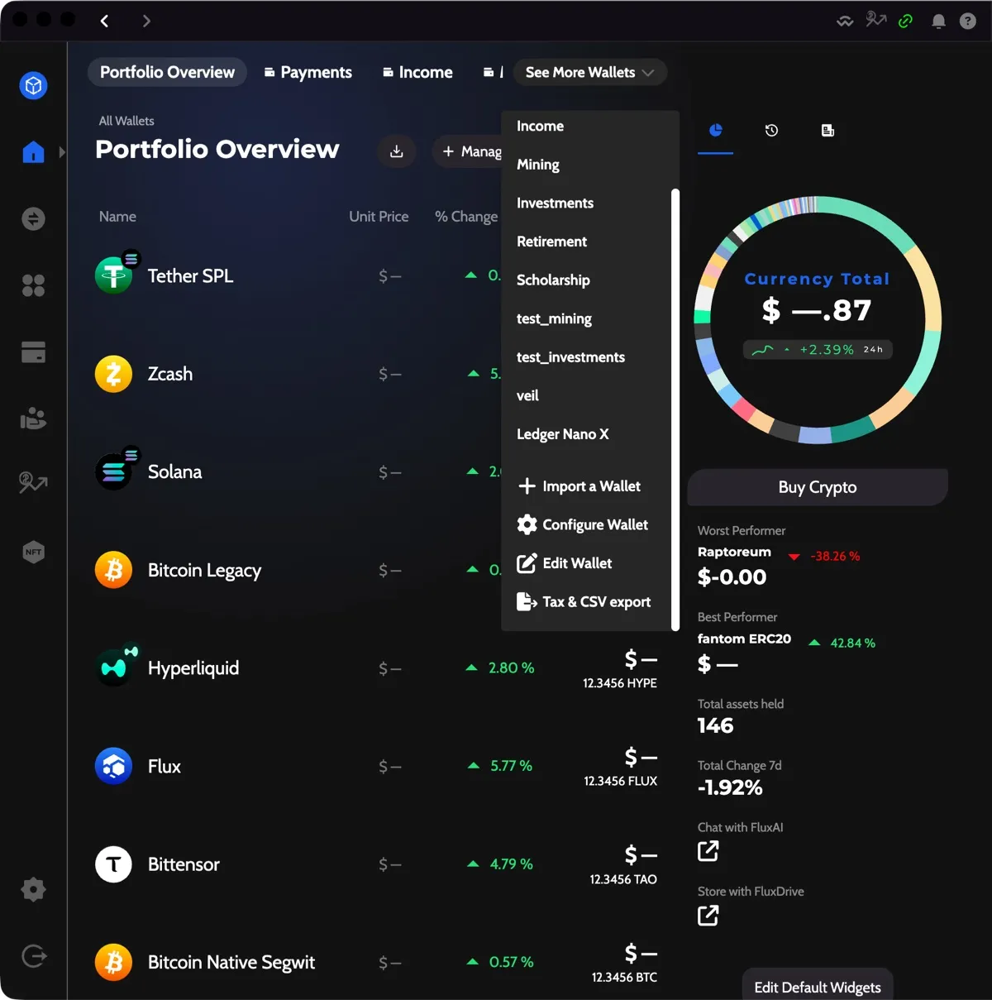
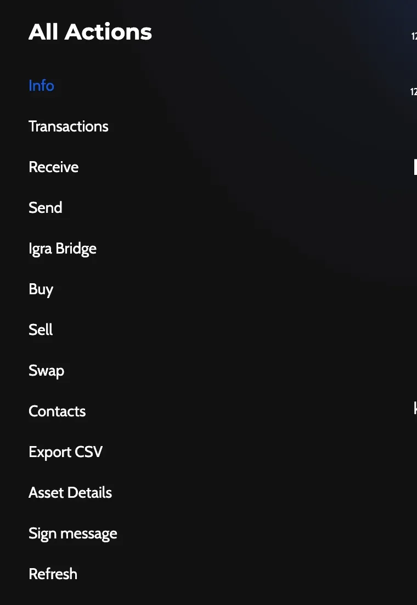
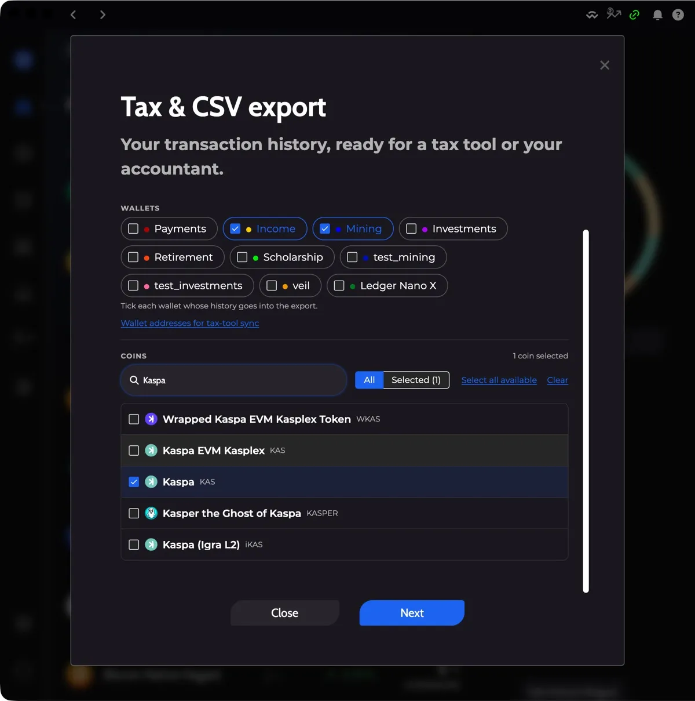
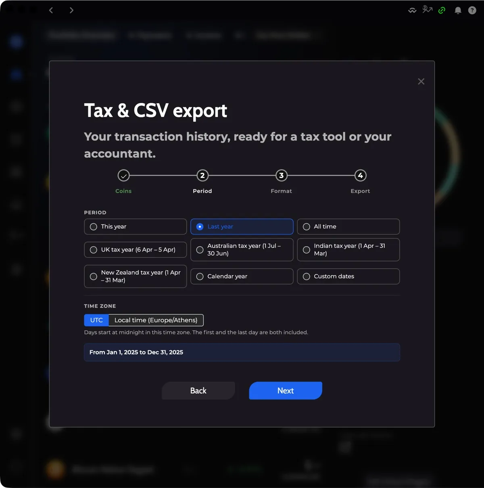
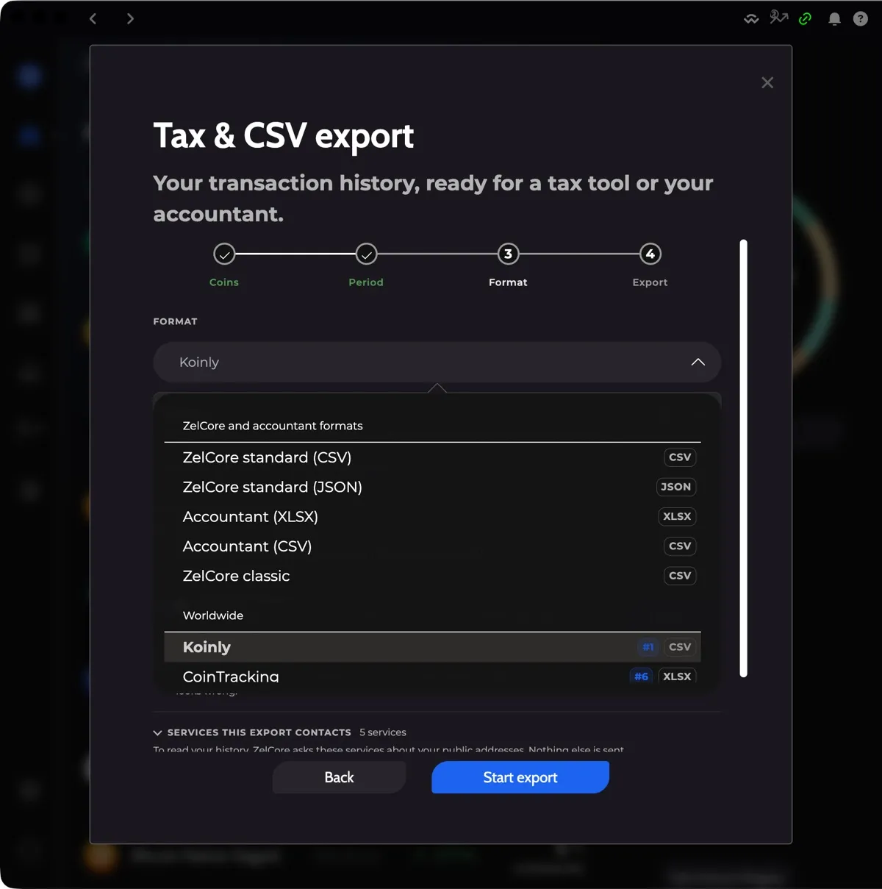
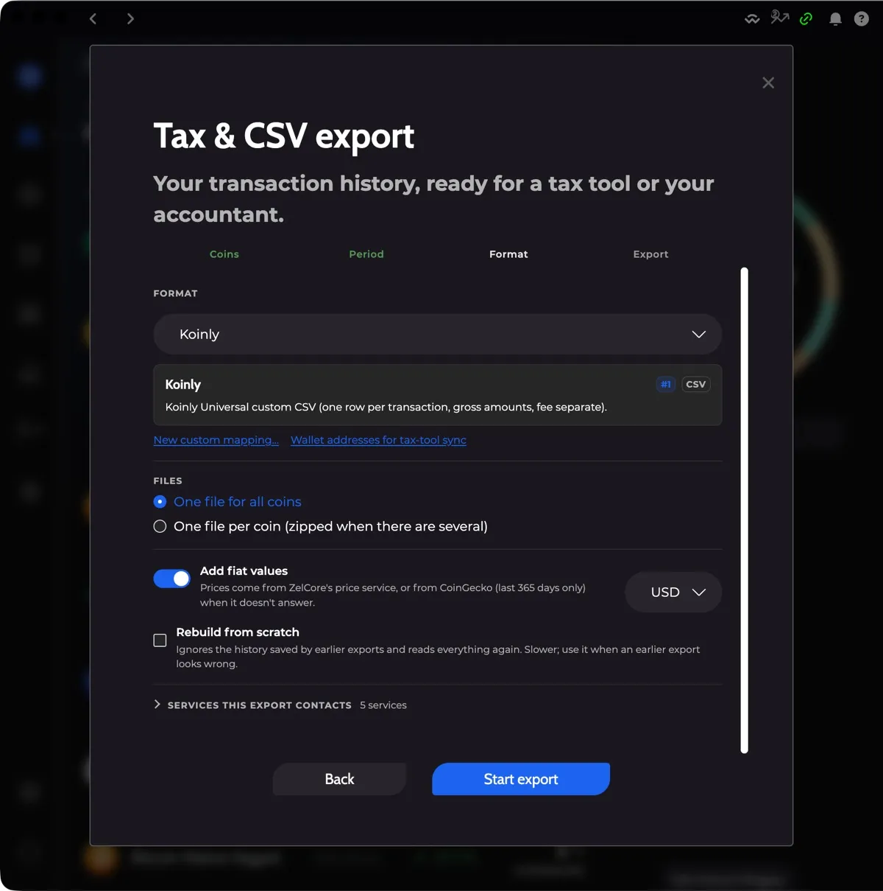
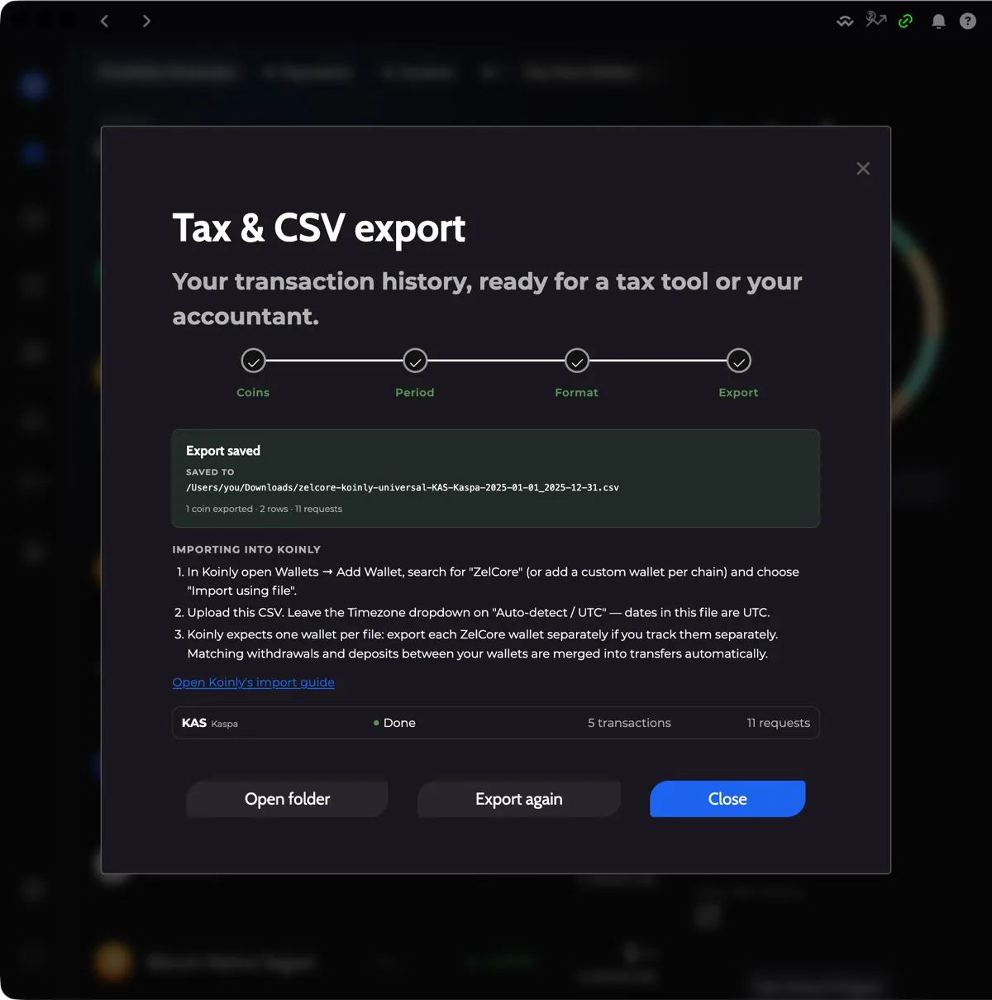
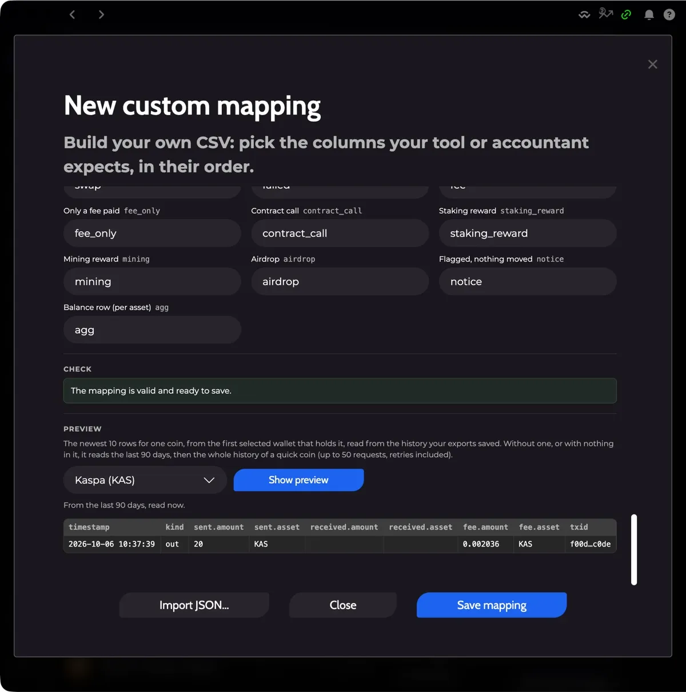
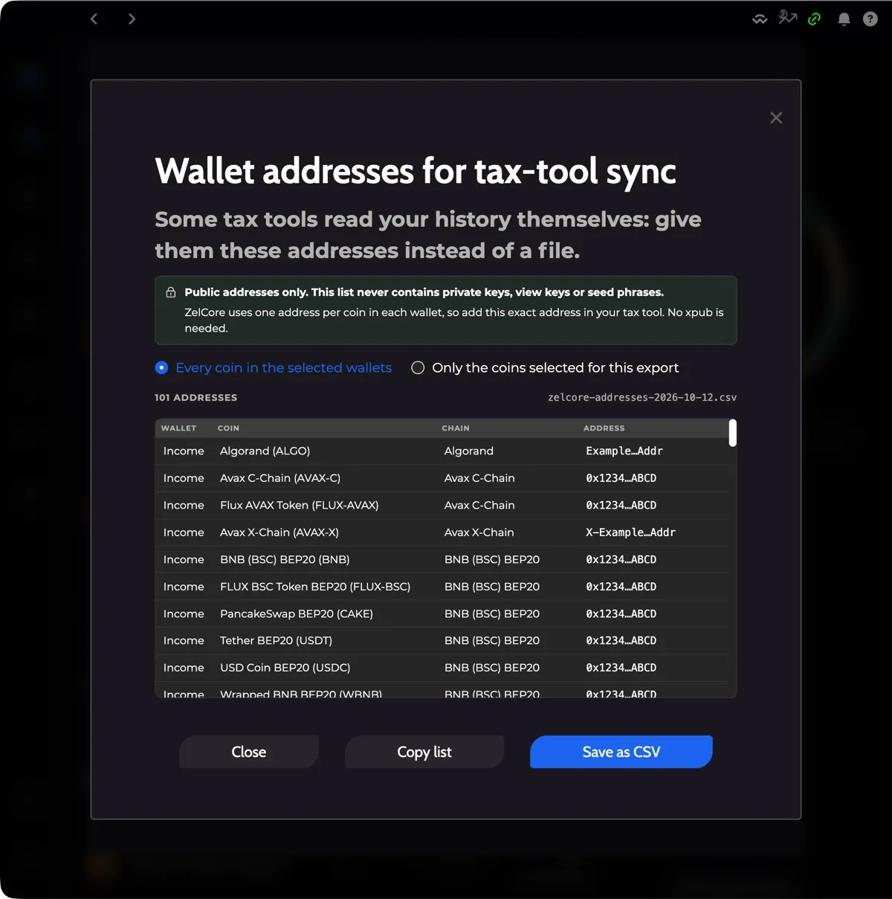

# How to Export Your Transactions for Taxes with Zelcore Tax & CSV Export

To export your transactions for taxes in Zelcore desktop, open **Tax & CSV export** from the wallet menu (or **Export CSV** on a coin), choose wallets and coins, a period and a format, then run the export and save the file. Zelcore builds the file on your device from public blockchain services and sends only your public addresses.

:::info Applies to Zelcore 8.39
The steps apply to Zelcore 8.39.0 (October 2026). Some screenshots come from an earlier version, so some screens may look slightly different.
:::

Background: [Zelcore Tax Export: Get Your Crypto History Filed](https://zelcore.io/academy/how-to/exporting-transaction-history-taxes)

---

## How it works and what it sends

The export runs on your device. Zelcore reads your history from public blockchain services, builds the file itself, and saves it to your computer.

- Only your **public addresses** are sent to those services. Private keys, seed phrases and view keys never leave your device.
- Before you start, the **Services this export contacts** list shows every server the export will ask, coin by coin. If you use a proxy, the list says that every request goes through it.
- Zelcore keeps an **encrypted copy** of the history it has read on your device. A repeat export only reads what is new, so it is much faster.
- Deleting an account in Zelcore also clears that account's export cache.

---

## Prerequisites

- Zelcore desktop application installed and logged in
- The coins you want to export are **activated** in the wallets you select. A coin that is not activated in a selected wallet is not exported.
- A tax tool account, if you plan to import the file. You do not need one to use the **Zelcore** or **Accountant** formats.

---

## Step 1: Open the Tax & CSV Export

There are two ways to open the export.

**From the wallet menu.** On the Portfolio, open **See More Wallets** and choose **Tax & CSV export** at the bottom of the menu, under **Edit Wallet**. This opens the export for all your wallets and coins.

**From a coin screen.** Open a coin and click **Export CSV** in the coin's **All Actions** list. The export opens with that coin already selected.

:::note
If a coin cannot be exported, **Export CSV** shows a message that explains why instead of opening the dialog. See [Troubleshooting](#troubleshooting-and-faq).
:::

The dialog has four steps along the top: **Coins**, **Period**, **Format** and **Export**.

---

## Step 2: Choose Wallets and Coins

The **Coins** step is the first one.

1. Under **Wallets**, tick each wallet whose history you want in the export. You need at least one.
2. Under **Coins**, pick the coins. Use **Search coins** to find one, **All** and **Selected** to switch the list, **Select all available** to tick every coin that can be exported, and **Clear** to start over. You need at least one coin.
3. Click **Next**.

Coins that cannot be exported are greyed out and show a short note, such as **Not available**.

---

## Step 3: Choose the Period

On the **Period** step, pick one option:

| Option | What it covers |
|--------|----------------|
| **This year** | The current year |
| **Last year** | The previous year |
| **All time** | Everything up to today |
| **UK tax year (6 Apr – 5 Apr)** | You choose the year it starts in |
| **Australian tax year (1 Jul – 30 Jun)** | You choose the year it starts in |
| **Indian tax year (1 Apr – 31 Mar)** | You choose the year it starts in |
| **New Zealand tax year (1 Apr – 31 Mar)** | You choose the year it starts in |
| **Calendar year** | You choose the year |
| **Custom dates** | You choose a **First day** and a **Last day** |

Then choose the **Time zone**: **UTC** or **Local time**. Days start at midnight in that zone, and both the first and the last day are included. A line under the options shows the exact dates, for example **From 2025-01-01 to 2025-12-31**.

Click **Next**.

---

## Step 4: Pick a Format

On the **Format** step you decide what the file looks like.

### Format

Open the **Format** list and pick your tax tool. The list is grouped by region, and the most widely used tools carry a rank badge (**#1** is the most popular). The badge on the right shows the file type: CSV, XLSX or JSON. Under the list, a short description explains the selected format.

If your tax tool is not listed, or you only need the data for your accountant, use one of the neutral formats:

- **Zelcore standard (CSV)**: every field as a documented column
- **Zelcore standard (JSON)**: the full transaction ledger
- **Accountant (XLSX)** or **Accountant (CSV)**: a per-asset summary plus a ledger with a running balance
- **Zelcore classic**: the layout of Zelcore's previous export, for tools that already read it

See [Supported tax tools](#supported-tax-tools) for the full list.

### Files

Under **Files**, choose how the output is split:

- **One file for all coins**
- **One file per coin (zipped when there are several)**

Some formats decide this for you. In that case the choice is locked and a note says **This format decides how the files are laid out.**

### Add fiat values

Switch on **Add fiat values** to add a price to every row, then choose the **Currency**. Prices come from Zelcore's price service, or from CoinGecko when the first does not answer. CoinGecko only covers the last 365 days.

### Rebuild from scratch

Tick **Rebuild from scratch** to ignore the history saved by earlier exports and read everything again. It is slower. Use it when an earlier export looks wrong.

### Services this export contacts

Open **Services this export contacts** to see which servers will be asked about your public addresses. If a service has a daily request limit, the list shows how many requests the export can use and how many are left for the next export that day.

Some formats read each coin's full history to work out opening balances. For these, the first export can take longer.

---

## Step 5: Run the Export and Save the File

Click **Start export**.

The **Export** step lists each coin with its progress: **Waiting**, **Checking saved history**, **Fetching**, **Processing** and **Done**. It also shows the number of transactions and requests for each coin.

- **Hide** closes the window while the export keeps running. Open **Tax & CSV export** again to come back to it.
- **Cancel export** stops it. Nothing is saved.

When it finishes, Zelcore saves the file to your **Downloads** folder and shows **Export saved** with the file path. Click **Open folder** to see the file.

Below the result you get numbered steps for importing the file into your tax tool, and a link to that tool's own import guide. The buttons at the bottom let you run it again (**Export again**) or go back and change the options (**Change settings**).

---

## Reading the Result

After the export, a **Worth checking** section lists anything that needs your attention. Each flagged transaction also has a note in the file's `flags` column, so you can find it after importing.

How Zelcore treats the hard cases:

- **Nothing is dropped.** A row that Zelcore cannot price or classify is flagged. It is never removed and never given a value of 0. A row with no price shows **No price**.
- **Fees are rows of their own.** In the Zelcore classic layout, each fee is a separate row.
- **Moving funds between your own addresses.** The Zelcore classic layout shows only the fee for such a transfer. The Zelcore standard layout lists both sides, marked as a transfer to the same address, and only the fee counts as a cost.
- **Failed transactions keep their fee.** The fee is counted for the wallet that paid it, and the row shows no amount.
- **Contract calls, internal transfers and swaps are written out.** A swap appears with both of its sides.
- **The whole history is read.** The export reads each address's history to the end, instead of stopping after one page.

:::tip
Open the result in your tax tool and check the flagged rows first. A flag tells you what to look at, for example a token that Zelcore does not list, or a transaction whose outcome the node could not confirm.
:::

If your coins have no transactions in the period, the file is saved with its column headers only. If a format has no rows for your kind of transactions, Zelcore says so and suggests another format such as **Zelcore standard**.

---

## Supported Tax Tools

Each format follows the tool's published sample file.

| Tax tool | File type | Popularity rank |
|----------|-----------|-----------------|
| Koinly | CSV | #1 |
| CoinTracker | CSV | #2 |
| CoinLedger | CSV | #3 |
| Summ | CSV | #4 |
| Blockpit | XLSX | #5 |
| CoinTracking | XLSX | #6 |
| Coinpanda | CSV | #7 |
| Waltio | XLSX | #8 |
| Awaken | CSV | #9 |
| ZenLedger | CSV | #10 |
| TokenTax | CSV | #11 |
| Divly | CSV | #12 |
| Recap | CSV | #13 |
| Cryptact | CSV | #14 |
| Syla (Ledgers) | CSV | #15 |
| KoinX | XLSX | #16 |
| Tatax | CSV | #17 |
| rotki | CSV (two files: trades and events) | #18 |

Neutral formats:

| Format | File type |
|--------|-----------|
| Zelcore standard (CSV) | CSV |
| Zelcore standard (JSON) | JSON |
| Accountant (XLSX) | XLSX (two sheets: summary and ledger) |
| Accountant (CSV) | Two CSV files in one zip |
| Zelcore classic | CSV, one file per coin |

:::info
Cryptact and Recap only accept a single combined file, and Zelcore classic is always one file per coin. The **Files** choice is locked for these formats.
:::

---

## Custom Mappings

If no built-in format fits, build your own. On the **Format** step, click **New custom mapping…**. To change one you already saved, select it and click **Edit this mapping**.

The editor lets you set:

- **Name** and an optional **Description**
- **Start from**: copy the columns of an existing format, so you only change what differs
- **File type**: CSV or XLSX
- **Rows**: **One row per transaction**, **One row per asset movement**, or **One row per asset (balances)**
- **File settings**:
  - **Separator** (comma, semicolon or tab) and **Line endings** (LF or CRLF) for CSV
  - **Decimal mark** (point or comma)
  - **Amounts**: **Always positive** or **Negative when sent or paid** (the sign convention)
  - **Time zone**: **UTC** or **Local time**
- **Columns**: use **Add column** to add one, the arrows to reorder, and **Remove column** to delete one. For each column you set:
  - **Header**: the column name in the file
  - **Value**: a Zelcore field, **Fixed text** that is written in every row, or **Type label**
  - **Format**: for date columns a **Date format** (for example ISO 8601, or Unix time in seconds or milliseconds), for amount columns the number of decimals, and for asset columns how the asset is written (ticker, ticker with contract, contract only, and others)
  - A column can override the time zone, decimal mark or sign from the file settings
- **Type labels**: the text a **Type label** column writes for each kind of row, such as **Received**, **Sent**, **Swap** or **Fee row**

**Check** tells you whether the mapping is valid. If it is not, it lists what to fix before you can save.

**Preview** shows the newest 10 rows for one coin so you can see your layout on your own history. Pick the coin, then click **Show preview**. The preview reads the history your earlier exports saved. If there is none, it reads the last 90 days.

Click **Save mapping** when you are done. Your mapping then appears in the **Format** list under **Your mappings**.

**Import and export.** Use **Export JSON** to save a mapping as a file, and **Import JSON…** to load one. This lets you reuse a mapping on another account or share it with your accountant. Save your changes before you export, because **Export JSON** writes the saved version.

:::note
Mappings are stored per account. **Delete** removes a mapping from the account. Files you already exported with it are kept.
:::

---

## Exporting Your Address List

Some tax tools read your history themselves. For those, you give the tool your addresses instead of a file.

1. Open the list in either place:
   - On the **Coins** step, click **Wallet addresses for tax-tool sync** under the wallet list. The wallets you ticked decide what is listed.
   - On the **Format** step, click **Wallet addresses for tax-tool sync** under the format list.
2. Choose **Every coin in the selected wallets** or **Only the coins selected for this export**.
3. Check the table. It shows the **Wallet**, **Coin**, **Chain** and **Address** for each row.
4. Click **Copy list** to copy it, or **Save as CSV** to save a file named `zelcore-addresses-<date>.csv`.

The list holds **public addresses only**. It never contains private keys, view keys or seed phrases.

Zelcore uses one address per coin in each wallet, so add that exact address in your tax tool. No xpub is needed.

If a wallet and coin pair has no address, it is left out and the dialog says how many. The address may not have been created yet, or the wallet may not support the coin, as with a hardware wallet.

---

## Clearing the Export Cache

To remove the saved export history, open the **Extras** section of your account settings and click **Clear export cache**. This deletes the export history and the custom mappings saved for the current account, and the shared price cache. The next export reads everything again.

---

## Troubleshooting and FAQ

**Why does my coin say it cannot be exported?**
Some coins have no public history source left, so there is nothing to read. Examples are Fantom Opera, whose history service no longer exists, and VeriBlock, which was shut down. Their coin screen explains why. Zelcore does not guess or leave a partial file for them.

**Which coins are new in this version?**
Cosmos Hub, Osmosis, Cardano, Sui and BNB Beacon Chain can now be exported.

**The first export is slow. Is that normal?**
Yes. The first export reads each coin's full history, which can take a while for coins with many transactions. Zelcore then keeps an encrypted copy on your device, so the next export only reads what is new. Use **Rebuild from scratch** only if you need to read everything again.

**The Start export button is not available.**
Another export task is running, such as an export, a preview or clearing the cache. Wait until it finishes.

**A coin I selected was not exported.**
After the run, **Coins that weren't exported** lists each coin with the reason. A coin that is not activated in any selected wallet is skipped. A service with a daily request limit can also run out. The list shows the limit, so you can try again the next day.

**A row has no fiat value.**
Zelcore found no price for that asset at that time, usually for a token it does not list. The row is flagged **No price** and the value is left empty, never set to 0.

**My file has headers but no rows.**
There were no transactions in the period, or the format has no rows for the kinds of transactions you made. Try another period or **Zelcore standard**.

**What happens to my export cache when I delete an account?**
It is cleared along with the account.

**Does the export send my seed phrase or private keys anywhere?**
No. Only public addresses are sent to the services listed in **Services this export contacts**.

**Where is my file?**
In your Downloads folder. Click **Open folder** on the result screen to go there.

## Related

- [Zelcore Features Overview](/docs/features/overview)
- [Understanding Zelcore Accounts](/docs/getting-started/understanding-zelcore-accounts)
- [Troubleshooting Balance and Sync Issues](/docs/guides/troubleshooting-balance-sync-issues)
- [Wallet FAQ](/docs/faq/wallet-faq)
